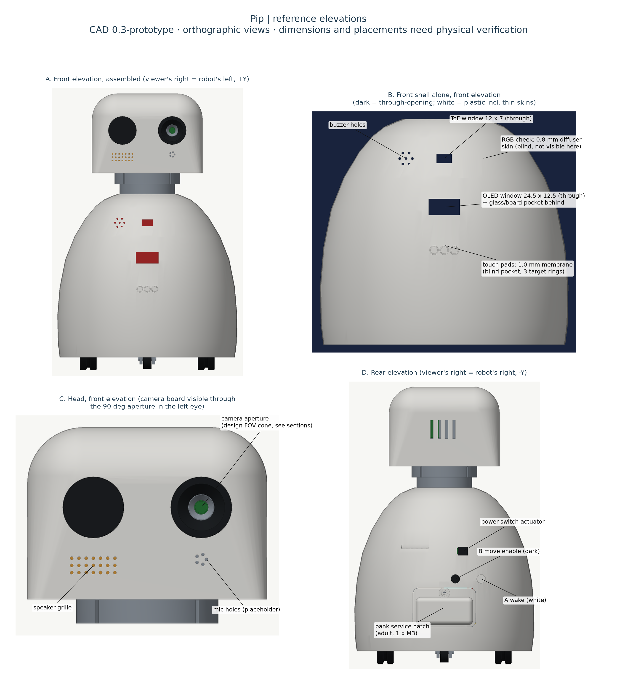
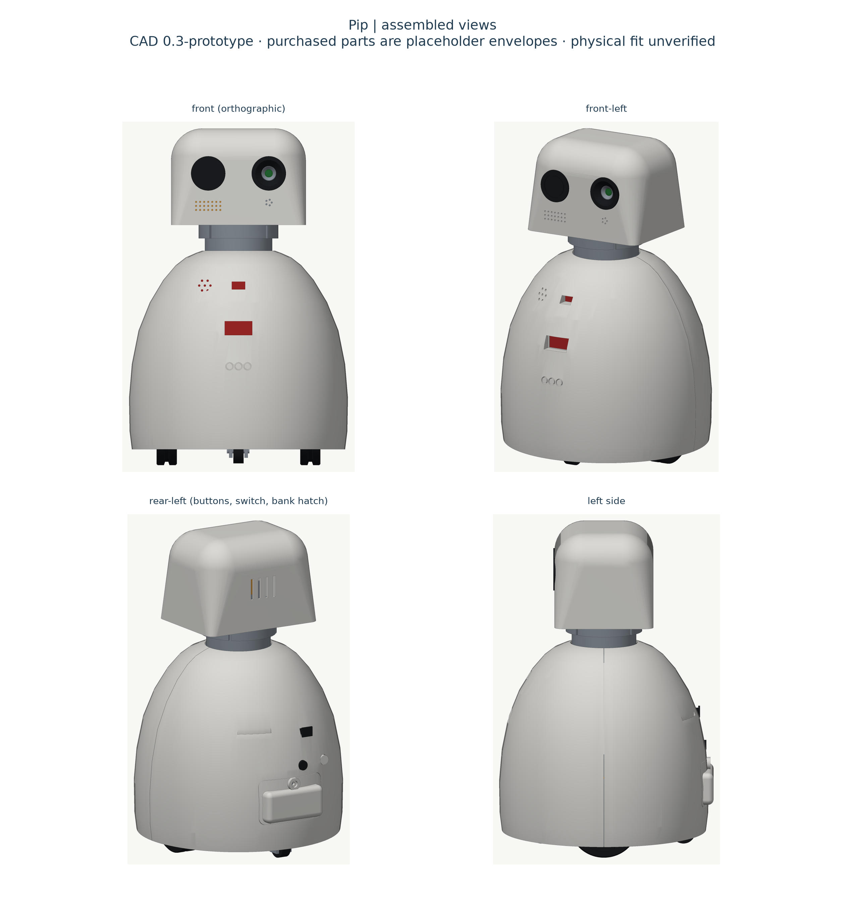
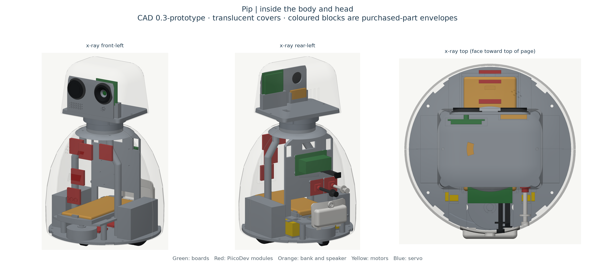
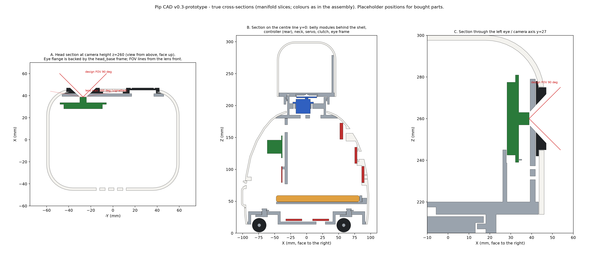
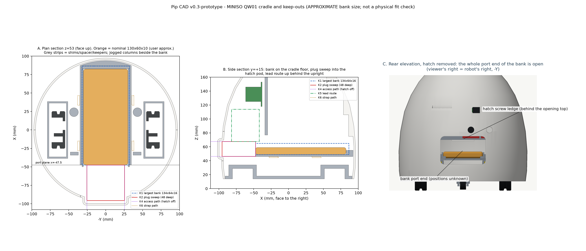

# 11 · Mechanical design, print plan and assembly (CAD v0.3 prototype)

For the step-by-step build procedure and labelled images, use the [illustrated assembly guide](14-illustrated-assembly-guide.md). This page is the mechanical design reference.

> **CAD v0.3 is a parametric prototype, not a final design.** Every bought-part dimension, hole position, button, switch and lens position is a **placeholder** (`# MEASURE` in [`params.py`](../cad/pip_robot/params.py)). v0.3 is laid out around the owned **MINISO QW01** power bank, using the user's **approximate** size of about 130 × 60 × 10 mm. That size has not been measured, and the bank has not been fitted. Do not print the full set until the parts are measured ([12](12-measurement-calibration-checklist.md), §A0 for the bank first) and the model is regenerated. Print the fit-test coupon first.

## 1. Tooling and reproducibility

- Python + [manifold3d](https://github.com/elalish/manifold) (guaranteed-manifold CSG). All dimensions are in `cad/pip_robot/params.py`.
- `scripts/cad.sh` runs everything in a throwaway `uv` environment. It builds the parts, exports the STLs, re-checks them with trimesh, runs the geometry checks and the bank-fit regression, and renders the previews. Rendering takes several minutes; `--no-render` skips it.
- `scripts/cad.sh --bank-fit-only` reruns only the QW01 bank-fit regression (seconds, writes no files). Rerun it after entering the measured bank size.
- **Previews** are drawn from the exported meshes by a small per-pixel z-buffer rasteriser (`cad/render.py`), so openings show truthfully. The cross-sections are true slices of the solids. (v0.1's "red triangles" were a matplotlib depth-sorting artifact; the mesh was correct.)
- No slicer was run, so there are no print-time or support numbers. Nothing has been printed.

## 2. Layout (assembly coordinates: +X forward, +Y robot's left, +Z up, origin on the floor at the centre)

| Item | v0.3 placement |
|---|---|
| Overall | ~300 mm tall; body Ø ~195 mm; head 120 W × 92 D × 86 H (unchanged) |
| Body shell | Revolved egg/bell profile, 2.4 mm wall, split front/rear at X = 0, bottom edge 14 mm above the floor. Same outline as v0.2; the body was **not** widened. |
| Frame | Base plate + 2 front columns + rear upright + top deck with the neck. Base, columns and deck are screwed together (4 × M3). **v0.3:** each column's lower end moves outboard to (24, ±43) beside the bank. The column jogs back in between z 138 and 162 to the unchanged deck sockets at (24, ±27). |
| Drive | Ø65 printed wheels on TT motors, track 128 mm; casters front and rear, 1.5 mm above the drive plane (unchanged) |
| Battery | QW01 lying flat, long axis fore-aft, on the tray at z 49. The port end faces the rear on the plane x = −47.5; the bank's front end is near the belly. See §2a. |
| Bank access | **Rear service hatch** (replaces the v0.2 sliding charge door), z 40–82, 68 mm wide, 1 × M3. Removing it exposes the whole port end. |
| Controller | Kitronik board + Pico on the rear face of the upright, z 118–153, Pico side facing the rear (unchanged) |
| Rear buttons | Two PiicoDev Buttons on the upright at z 92: A (wake, white plunger) at y −40, B (movement enable, dark plunger) at y −12 (unchanged) |
| Body power switch | Printed push-rod from the rear shell to the controller's slide switch (switch position placeholder; unchanged) |
| Front (belly) | OLED window z 122, touch membrane z 92, ToF window z 160, RGB cheek and buzzer holes z 160 (unchanged) |
| Neck and head | Unchanged from v0.2 (§4) |

### 2a. MINISO QW01 cradle (v0.3)

The bank's size comes from the user's estimate of about 13 × 6 × 1 cm. That estimate is **not exact**, so the cradle is built for a **band** of sizes, with printed fillers for the size actually measured:

| | Nominal (user approx.) | Accommodated band | Where it is set |
|---|---|---|---|
| Length (X) | 130 | 126–134 | `Battery.len_nom`, `len_range` |
| Width (Y) | 60 | 56–64 | `w_nom`, `w_range` |
| Thickness (Z) | 10 | 8–16 (thickness is the least certain) | `t_nom`, `t_range` |

- **Tray (cradle):** a continuous floor under the whole bank footprint. Side rails and a front wall 6 mm high are sized for the largest bank, with 0.3 mm left over. The rails are lower than the thinnest bank, so the straps press on the bank. The **rear end is fully open**, and the floor behind the port plane is cut away so plug overmoulds that hang below the bank are not blocked.
- **Fillers (printed, removable, regenerated from the measured size):** two side shims (1.8 mm at the nominal width; 31.8 − W/2 in general) and one front spacer (3.8 mm at the nominal length; 133.8 − L). The spacer keeps the **port end on the same plane** while the size stays in the fixed cavity range. Near the largest sizes, the generated fillers become too thin; the build rejects them and the keepers/fillers must be redesigned. Cavity clearance alone does not approve retention.
- **Retention (not friction only):** two hook-and-loop straps over the bank, through slots beside the rails and under the tray. The bank is also boxed in by the rails and shims at the sides and the spacer at the front. At the rear, a low corner keeper on each shim (4 mm in from the side, 3 mm high) stops it sliding back. The keepers sit outside the assumed port zone. Trim them off if a port turns out to be nearer the edge, and rely on the straps.
- **Ports: positions unknown.** The model does not place any port. Instead it keeps a volume open behind the end face for any port centre within ±16 mm of the centre line and at least 3 mm inside the top and bottom faces. That volume is 51 W × 21 H × 48 mm deep and allows for the largest of the three plugs:
  - ADA3628: 52 × 19 × 11.4 mm overall per Adafruit, so ~40 mm beyond the port face plus 8 mm for the wires.
  - USB-A → USB-C cable overmould: 32 mm placeholder plus a 12 mm bend.
  - Micro-USB charging plug: 25 mm placeholder plus a 15 mm bend.

  It assumes **all ports are on the rear end, which is not confirmed**. If the micro-USB input is on a side or the far end, the rails block it and the design must change ([12](12-measurement-calibration-checklist.md) Q5).
- **Why the hatch has a pod:** the body is ~190 mm across inside at tray height. A 134 mm bank, its front clearance and a 48 mm straight plug-plus-bend need about 186 mm. The rear hatch therefore carries a shallow rounded pod that stands 4.5 mm proud of the shell at the centre and more towards its edges. Only the hatch changes; the body outline is the same. A right-angle USB-A adapter would remove the need for the pod but is not in the parts list.
- **Lead route:** both output leads leave the plug area upwards on the robot's **left (+Y)**, behind the upright and away from the rear-button plungers on the right (−Y). They reach controller height and the upright's existing cable windows (z 150–170). The in-line camera switch holder is still not modelled.

### 2b. Bank access, unplugging and charging (adult only)

This procedure assumes all required ports face the rear opening. Confirm that layout before relying on this procedure. Follow [05](05-power-budget-charging.md) for the electrical side.

1. Put the robot to sleep and switch the body switch off.
2. Turn the robot so the back faces you. Undo the **one M3 screw** at the top of the rear hatch. Tilt the hatch top out and lift it off its two bottom tongues.
3. The whole port end of the bank is now visible about 45 mm inside the opening. Unplug **both** robot leads (the ADA3628 and the USB-A → USB-C cable) by their plug bodies, not by the wires.
4. Plug the micro-USB charging cable into the bank's input and charge as [05](05-power-budget-charging.md) describes. The hatch stays off while charging. There is no cable notch, so the hatch cannot close on a lead.
5. Unplug the charger. Refit both robot leads in their marked ports, routing them up the left side. Hook the hatch's bottom tongues in behind the shell, swing it closed, and refit the screw. Do not over-tighten it: it threads into printed plastic.

To **remove the bank**, take the rear shell off (§8), unplug the leads, open both straps and lift the bank up and back out of the cradle.

CAD static-stability **estimate without the bank** (guessed component masses): CG ≈ 112 mm above the floor; tip angles ~30° sideways and ~28°/27° forward/back. **The QW01's mass is unmeasured, so it is not included and no tip angle with the bank is claimed.** The bank sits low (centroid z ≈ 54 mm) and slightly forward (x ≈ +18 mm), so it should lower the CG. Weigh it, then run the tilt-table test T-SAF-1.

## 3. Drive layout

Two driven centre wheels and two swivel casters in a diamond layout. Pip turns on the spot about its own centre (good for "look at the child"). The swivel casters avoid the scrub of skid-steer. The casters sit 1.5 mm high, so Pip rests on both drive wheels plus one caster and keeps traction on both drive wheels. Speed is capped at ≤ 0.25 m/s by calibrated PWM (T-DRV-3). Tyres are O-rings or thick rubber bands in a 3 mm groove. Unchanged in v0.3.

## 4. Head and neck

Unchanged in v0.3.

- The FS90 hangs on ledges inside the fixed neck sleeve. The head's weight and any pull go into the neck flange, not the servo bearings.
- **Slip clutch:** four spring tongues in the clutch disc click into eight notches in the head floor. They slip before the servo gears are forced. Tune `clutch_arm_t` (print 1.2 / 1.6 / 2.0 mm; T-PAN-2). After a slip, the commanded angle no longer equals the actual angle ([02](02-architecture.md) §4.1).
- **Stops** at ±75° (pin in an arc groove). Firmware limit ±70°.
- **Camera:** the DFR1154 board slides into a cradle on the head base. Its lens front sits 0.5 mm behind the eye frame. The left eye and the frame have a conical aperture for a **90° design FOV**, and the CAD checks that this cone is unobstructed (report §3c). The lens itself is 160° (DFRobot), so the outer field is deliberately masked by the eye. **The lens position on the board is a placeholder.**
- **Speaker:** the mount currently uses the earlier optional spare's 30 × 20 × 5 mm envelope, in side rails behind the eye frame. DFRobot lists a speaker in the DFR1154 package. Confirm that package, measure the supplied speaker and regenerate its mount before printing. Do not buy a duplicate speaker for this placeholder.
- **Cable:** one USB-C lead (camera power) through a slot in the deck, up the neck and through the head floor slot, with service loops (T-PAN-3).

## 5. Shells, openings, service

| Feature | v0.3 |
|---|---|
| Screen | OLED viewing window 24.5 × 12.5 mm through the shell; glass pocket and board pocket behind |
| Touch pads | 1.0 mm membrane over the touch module (blind pocket) with three shallow target rings; test 0.8/1.0/1.2 mm |
| ToF | Open 12 × 7 mm window (no cover, to avoid infrared crosstalk) |
| RGB cheek | 0.8 mm white diffuser skin |
| Buzzer | 7 holes |
| Rear | Two plunger bosses; switch actuator slot; vents. **New:** a 68 × 42 mm rounded bank-hatch opening at z 40–82, with an internal screw ledge above it. The v0.2 charge-port window, LED window, door rails and grip slot are removed. |
| Rear hatch | Shell patch with a shallow pod, two bottom hook tongues, one counterbored M3 at the top. The bank's charge LEDs (position unknown) are seen with the hatch off. |
| Head | Eye sockets; speaker grille; mic holes (placeholder); rear vents |
| Service | Adult turns Pip over and removes the 4 shell screws from underneath, then lifts the shells off. The rear shell exposes the Pico USB, the controller terminals and the bank. The hatch comes off with the rear shell. |

## 6. Retention and fasteners (every child-reachable or service part)

All screws are **pan-head thread-forming screws for plastics**. They need a screwdriver and are recessed or underneath, so a child cannot open Pip by hand. Pilot holes are 2.5 mm for M3 (tune with the coupon). Screw lengths are chosen so tips stay inside bosses. **Screws and straps are not in the priced BOM** (B16).

| Part | Retained by | Fastener | Tool to remove | Notes / test |
|---|---|---|---|---|
| Front and rear shells | Two ribs in base notches each + **2 screws each from under the base** into rim bosses | 4 × M3 × 10 (counterbored in the base) | Screwdriver, robot turned over | — |
| **Rear bank hatch** (new) | Two bottom tongues hooked behind the shell + **1 screw** into the shell ledge (6 mm engagement) | 1 × M3 × 8, head in a counterbored boss | Screwdriver | Adult-only access to the lithium bank. Test: 10 on/off cycles (docs/12 C) |
| Top deck ↔ columns ↔ base plate | Pegs in sockets + **screws at both ends of each column** | 4 × M3 × 12 | Screwdriver (deck screws are under the head: remove the head first) | Lifting Pip by the head cannot pull the deck off. Jogged columns: check for bending (docs/12 C) |
| Head cap ↔ head base | Cap sits on the base floor; 2 screws up through the floor into cap bosses | 2 × M3 × 10 | Screwdriver; head off first | — |
| Head ↔ neck | 4 snap hooks under the neck flange, hidden inside the body shoulder | — | Adult, shells off | Pull test T-SAF-9 (≥ 50 N by hand scale) |
| Eyes | Inserted **from inside** the cap; inner flange larger than the socket; backed by the head-base eye frame (0.3 mm gap) | — | Head apart | Cannot be pulled out or pushed in once assembled |
| Plungers | Inner collar larger than the shell hole; tip 0.3 mm above the button | — | Shell off | — |
| Switch actuator | Outer grip larger than the slot; inner fork around the switch knob | — | Shell off | Concept; re-model after measuring the switch |
| Wheels | Press fit on the TT shaft; outer guard wall limits axial travel to ~4 mm, with ≥ 5 mm of shaft still engaged | Optional screw into the shaft end if the motor has a hole (MEASURE; unpriced) | Base access | T-MECH-2 |
| Casters | Stem clip on top of the tower; axle pin with a split snap tip | — | Base access | Small parts under the base: pre-session check |
| Controller board | 4 screws into upright standoffs | 4 × M3 × 8 | Shell off | Kitronik holes are M3 clearance (datasheet) |
| PiicoDev Buttons | 2 screws each into standoffs | 4 × M2.5 × 6 | Shell off | Hole positions placeholder |
| Camera board, speaker | Slots/rails in the head base, enclosed by the cap | — | Head apart | No screws; add a clip if loose |
| **Power bank (QW01)** | Cradle floor + rails, side shims, front spacer, rear corner keepers + **2 hook-and-loop straps** through the tray slots | 2 straps, ~12 mm wide, ~250 mm long (unpriced) | Rear shell off | docs/12 Q12–Q13 |
| Motors | Cradle + 4 printed straps held down by the tray | — | Shell + tray off | — |
| Front PiicoDev modules | Pockets/pegs | optional M2.5 | Shell off | Hot glue allowed if loose (not soldering) |

**Fastener total:** 15 × M3 (4 shell, 1 hatch, 4 frame, 2 head, 4 controller), 4 × M2.5 and 2 hook-and-loop straps. All unpriced. v0.2 had 14 × M3 and one strap.

This total excludes the FS90's tab and horn hardware, B18. Its sizes and whether it is supplied are unconfirmed. The deck has provisional 1.8 mm pilot holes. Measure the servo and ledges before selecting screws or calling servo retention complete.

## 7. Parts list and print settings (PLA, 0.4 mm nozzle)

| Part (STL in `cad/out/stl/`) | Qty | Colour | Layer / walls / infill | Orientation |
|---|---|---|---|---|
| fit_test_coupon + fit_test_pegs | 1+1 | any | 0.2 / 3 / 20% | flat; **print first** |
| base_plate | 1 | grey | 0.2 / 4 / 30% | flat; support only under the caster-tower roofs |
| tray (QW01 cradle) | 1 | grey | 0.2 / 3 / 25% | upside down |
| bank_shim_L, bank_shim_R (new) | 1 each | grey | 0.2 / 100% | as exported; **regenerate from the measured width first** |
| bank_front_spacer (new) | 1 | grey | 0.2 / 100% | as exported; **regenerate from the measured length first** |
| column_L (used twice) | 2 | grey | 0.2 / 5 / 50% (jog carries bending) | lying down, jog flat on the bed |
| rear_upright | 1 | grey | 0.2 / 3 / 25% | flat |
| top_deck | 1 | grey | 0.2 / 4 / 30% | deck down |
| front_shell, rear_shell | 1 each | white | 0.2 / 3 / 15% | seam face down; tree supports |
| rear_hatch (new; replaces charge_door) | 1 | white | 0.2 / 4 / 30% | pod face down; support under the tongues |
| head_cap | 1 | white | 0.2 / 3 / 15% | open side down |
| head_base | 1 | grey | 0.2 / 3 / 25% | skirt down; supports under the floor overhang, hooks and cradle |
| clutch_disc | 1 (+2 variants) | grey | 0.12 / 3 / 100% | flat |
| eye_left_camera, eye_right | 1 each | black | 0.12 / 3 / 100% | as exported |
| drive_wheel_L / R | 1 each | dark | 0.2 / 4 / 40% | outer face down |
| motor_strap | 4 | grey | 0.2 / 3 / 50% | as exported |
| caster_fork_F, caster_wheel_F | 2 each | grey/dark | provisional 0.2 / 4 / 40% | as exported; inspect supports in slicer |
| caster_axle_F, caster_clip_F | 2 each | grey | provisional 0.12 / 4 / 100% | as exported; test split tip and clip strength on spares |
| plunger_wake (white), plunger_move (dark) | 1 each | as named | 0.12 / 100% | as exported |
| switch_actuator | 1 | dark | 0.12–0.2 / 100% | as exported |

Printed part count: 28 STL files (26 parts plus the coupon and pegs), 36 printed pieces including the coupon and pegs. v0.2 had 25 files: `charge_door` was removed and `rear_hatch`, `bank_shim_L`, `bank_shim_R` and `bank_front_spacer` were added. Bed fit (bounding box, from the report): every part fits a 220 × 220 × 250 mm bed. The base plate, tray and both shells do **not** fit a 180 mm bed; split them in the slicer and pin the halves.

## 8. Assembly sequence

The [illustrated guide](14-illustrated-assembly-guide.md) adds detailed checkpoints. Its Stage 5 blocks final base printing until the motor and wheel insertion sequence is proved. Collision-free assembled positions do not establish an insertion path.

1. Coupon → choose clearances → **measure the QW01 (docs/12 §A0)** → update `params.py` → `scripts/cad.sh --bank-fit-only` → full regenerate.
2. Base: base modules on pegs; motors in cradles with straps; wheels with tyres; casters with clips and axles.
3. Columns into the base, **screwed from below** (lower ends at y ±43, jogs inward). Thread both bank straps through the tray slots. Fit the tray. Rear upright into the tray.
4. Controller (with Pico) and both PiicoDev Buttons screwed to the upright. Wiring per [04](04-wiring-pin-plan.md), only after the gates in [05](05-power-budget-charging.md).
5. Deck onto the columns and upright, **screwed from above**. Servo onto its ledges. Camera USB lead through the deck slot.
6. Bank, with the front shell off and all power disconnected: fit the front spacer. Keep the port end rearward, angle it under the upright arch, lower the bank and slide it forward to the spacer. This is an unverified fit sequence; stop if it needs force. Fit both side shims and close both straps. Leave both output leads disconnected during the dry build. Connect them only after the electrical gates clear the circuit, routing them up the left (+Y) side behind the upright.
7. Head: eyes into the cap from inside. Camera board and speaker into the head-base cradles. Horn + clutch on the servo (servo centred). Cap onto the base (2 screws from below). Lower the head onto the neck until the hooks snap. Check rotation and stops.
8. Front shell: modules into pockets; connect the touch cable; seat the ribs; screws from below. Rear shell: plungers and actuator; seat; screws from below. Rear hatch: tongues in, swing closed, 1 screw. Check that it closes without pressing on the plugs (docs/12 Q15).
9. Bring-up checks in [09](09-build-plan-milestones-tests.md) §2.

## 9. What the CAD checks establish (and what they do not)

Established, on placeholder geometry:

- Closed, valid meshes (manifold3d and trimesh). Bed fit by bounding box.
- No overlap above 1 mm³ between parts outside a listed set of intended contacts. Each intended contact is printed with its overlap volume and reason. v0.3 added **no** new exclusions and removed the old bank/tray one.
- Selected gaps, e.g. plunger-to-button 0.30 mm, eye-flange-to-frame 0.30 mm and hatch-to-shell 0.28 mm.
- Caster swivel sampled every 5°; head pan sampled every 5° from −75° to +75°. The 90° camera cone is unobstructed.
- **Bank-fit regression (report §3d), each with zero overlap (≤ 0.1 mm³) against every part:**
  - K1: the largest accommodated bank, 134 × 64 × 16 mm, sharp-cornered.
  - K2: the plug-and-bend sweep (fillers and hatch included).
  - K3: the open end face, 25 mm deep (only the removable keepers enter it).
  - K4: the straight access path with the hatch removed.
  - K5: the lead route.
  - K6: the strap path.

  Also checked: cavity margins (0.3 mm), 100% floor under the nominal, largest and smallest footprints, the nominal bank's 0.3 mm gaps to its fillers, and the hatch pod's clearance to the plug sweep. A built-in regression confirms the check still detects the v0.2 problem: the QW01 at the old position collides with the old straight columns (1813.6 mm³ in total).

**Not established:**

- Real fit of any bought part, **including the QW01**. Its size is a user estimate, and its port positions, which end the input is on, its LEDs and its mass are unknown.
- Real plug and lead sizes; strap tension; that the bank cannot shift under a knock.
- That the intended-contact overlaps are correct press/peg fits.
- Continuous motion clearance between samples; cable routing and twist.
- Screw engagement and strength, including the hatch ledge thread and the column jog; printability; strength (no FEA); toy compliance; real camera view.
- Stability with the bank.

## 10. Known v0.3 limitations

- All bought-part positions are placeholders: controller switch, Buttons, camera lens, mic, USB-C sockets, **all QW01 ports and its LEDs**.
- The QW01 cradle assumes all bank ports are on one (rear) end. A side or far-end micro-USB input would need a rail window and a new access route.
- With the hatch on, plug room relies on the hatch pod (pod-to-sweep clearance ~1.9 mm in the model). Longer real plugs need a right-angle adapter (unpriced) or a deeper pod.
- The columns now carry a jog. Its bending strength is unanalysed; print it solid enough and load-test it.
- Holder for the in-line camera switch is not modelled. A single all-branch power switch is not modelled.
- Plain butt seam between the shells (no tongue). The shell top is located by the deck edge only.
- Mass and stability are estimates and exclude the bank. Strength is unanalysed.
