# 14 · Illustrated assembly guide (Pip v0.3 prototype)

This guide takes a beginner through building Pip from printed parts and plug-in electronics, one stage at a time. No soldering is needed at any stage.

> **Read this first.**
>
> - **Pip has not been built.** The pictures are CAD renders and labelled instructional diagrams, not photos of a built robot. Bought parts in the CAD appear as simple placeholder blocks ("envelopes") whose sizes come from listings, not measured parts. Exploded views explain final relationships; they do not prove an insertion sequence.
> - **Purchases are on HOLD** ([00](00-status-assumptions-decisions.md) D1). The full-concept comparison is AU$116.98 before delivery and unpriced items ([08](08-bom-budget-sourcing.md)). The optional savings proposal comes to AU$92.27 plus unpriced items ([15](15-cost-reduction-options.md)). Neither is an approved order, and neither meets the AU$70 cap.
> - **Wiring and power are on HOLD.** The body branch's estimated fault current, 3.3–4.1 A, exceeds the QW01's reported 5 V / 2 A per port. The bank's combined output limit is unknown ([05](05-power-budget-charging.md) §3). Do **not** connect or power the current motor circuit. A protected redesign may be tested only under the approved bench plan in Stages 14–15. Normal operation waits for gates PG1–PG7 to pass.
> - **No firmware exists.** Stage 16 describes future work only.
> - **What you may do now:** measure the parts you own, print the fit coupon, and dry-assemble the printed parts with the bank **disconnected**, once the measurements are in the CAD.

Stage labels used below:

| Label | Meaning |
|---|---|
| **STOP** | The design is unfinished at this point. Do not improvise. Record the problem and wait for a CAD or documentation change. |
| **HOLD** | Blocked by the power gates or the purchase decision. Do not carry out this step yet. |
| **FUTURE** | Depends on firmware or software that does not exist yet. |

The build stages list parts, tools, steps and checkpoints. Do not pass an unresolved STOP or HOLD to complete the robot. You can still measure owned parts and inspect the model independently.

Figure labels such as Detail 4 or Wiring 2 identify pictures. Follow the Stage headings for the build order. Open an image separately to zoom in on its labels.

Inspect the same CAD in the [interactive section viewer](../cad/viewer/index.html). Download the HTML file before opening it locally, because GitHub displays HTML as source. Use its independent X, Y and Z cuts to inspect parts. Read [the viewer's editing instructions](../cad/viewer/README.md) to change its controls or regenerate its geometry.

---

## Stage 0 — Safety and supervision

Pip is a supervised school prototype. It is not a certified toy ([06](06-safety.md)).

1. An adult does every step that involves the power bank, screws into the base, or the rear hatch.
2. Never open, drill, clamp hard on or modify the MINISO QW01. Stop and set it aside if it is warm, swollen or damaged.
3. Unplug both robot leads from the bank before any work inside the body. Software sleep and the body switch are **not** a full power-off ([05](05-power-budget-charging.md) §2).
4. Deburr printed parts. Check for sharp edges and loose small parts before the robot goes near a child.
5. Keep screws, caster clips, axle pins and plungers in a labelled tray. They are choking-size parts.

**Checkpoint:** an adult has read [06](06-safety.md) §1 and agreed to supervise.

---

## Stage 1 — Tools and inventory

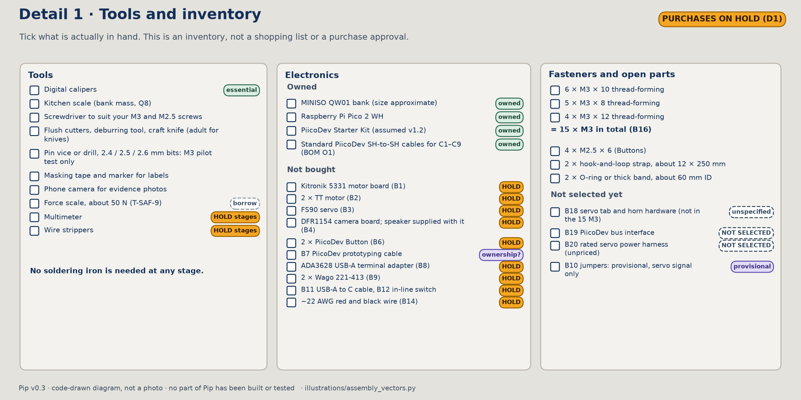

### Tools

| Tool | Used for | Notes |
|---|---|---|
| Digital calipers | Measuring bought parts (Stage 2) | Essential |
| Kitchen scale | QW01 mass (Q8) | |
| Screwdriver to suit your M3 and M2.5 screws | All fasteners | The screw head type is not fixed in the design. Match the driver to the screws you buy or borrow |
| Flush cutters, deburring tool or craft knife | Removing supports, cleaning holes | Adult for knives |
| Hand drill or pin vice with 2.4, 2.5 and 2.6 mm bits | M3 pilot-hole test only (Stage 3) | Not needed if a printed pilot test piece is added to the CAD |
| Masking tape and marker | Labelling leads, ports and parts | |
| Phone camera | Evidence photos (Stage 20) | |
| Hand-held force scale, about 50 N | Pull test T-SAF-9 | Borrow |
| Multimeter | **HOLD** stages only | Borrow from school; not in the BOM |
| Wire strippers | **HOLD** stages only | No soldering iron is needed at any stage |

### Printed parts

The registry in [`assembly.py`](../cad/pip_robot/assembly.py) exports **28 STL files** to `cad/out/stl/`. With repeats, that makes **36 printed pieces**, including the two calibration prints. The two extra clutch variants in Stage 8 are additional to the 36.

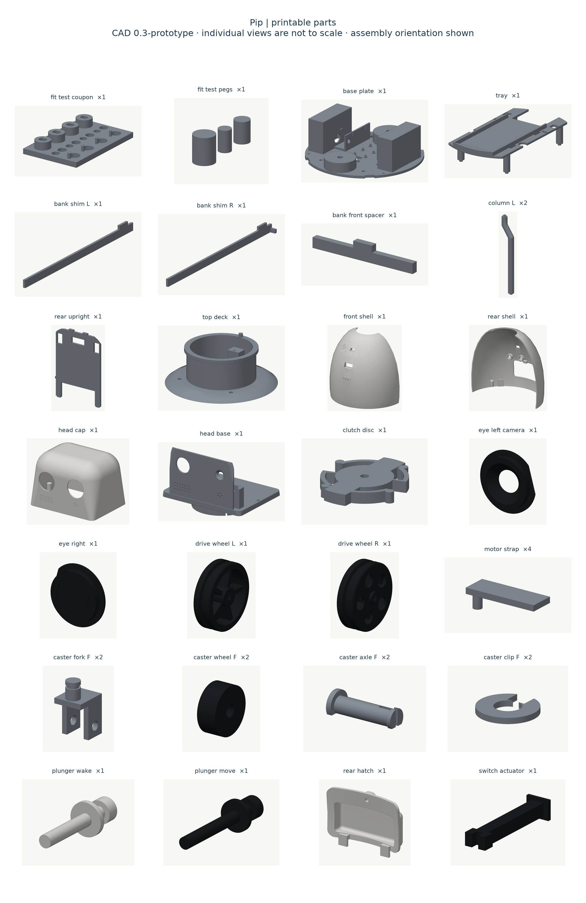

### Fasteners and consumables (all unpriced)

| Item | Qty | Where it goes |
|---|---|---|
| M3 × 10 thread-forming screw | 6 | 4 shell screws from under the base; 2 head-cap screws |
| M3 × 8 thread-forming screw | 5 | 4 controller-board screws; 1 rear-hatch screw |
| M3 × 12 thread-forming screw | 4 | Frame: 2 lower column screws from below, 2 upper column screws from above |
| **M3 total** | **15** | |
| M2.5 × 6 thread-forming screw | 4 | 2 per PiicoDev Button |
| Servo tab and horn hardware | Unspecified | B18. Confirm what the servo supplies, measure the tabs and ledges, and select suitable hardware before fastening the servo |
| Hook-and-loop strap, about 12 × 250 mm | 2 | Power-bank retention |
| O-ring or thick rubber band, about 60 mm inside diameter | 2 | Drive-wheel tyres |

"Thread-forming" screws cut their own thread in plastic. They go into a slightly smaller *pilot hole*, which Stage 3 calibrates.

### Bought and owned electronics

Lay out and label everything you have. Tick what is actually in hand.

| Part | Status | Notes |
|---|---|---|
| MINISO QW01 10,000 mAh bank | Owned | Size approximate; mass and port positions unknown |
| Raspberry Pi Pico 2 WH | Owned | |
| PiicoDev Starter Kit (OLED, RGB LED, atmospheric, buzzer, colour, touch, accelerometer, ToF distance, cables) | Owned | Assumed v1.2 ([00](00-status-assumptions-decisions.md) A1) |
| Kitronik 5331 motor driver, 2 × TT motors, FS90 servo, DFR1154 camera, 2 × PiicoDev Button, cables and connectors | **Not bought** (HOLD) | List in [08](08-bom-budget-sourcing.md) §3 |
| Speaker for the head | Supplied with the DFR1154 | DFRobot's [package list](https://www.dfrobot.com/product-2899.html) includes a speaker. **Do not buy a separate speaker.** When the camera arrives, confirm the retailer's package contains it |

**Checkpoint:** you have a written inventory. Parts not yet bought are marked as such.

---

## Stage 2 — Measure bought parts and the QW01 (before printing the full set)

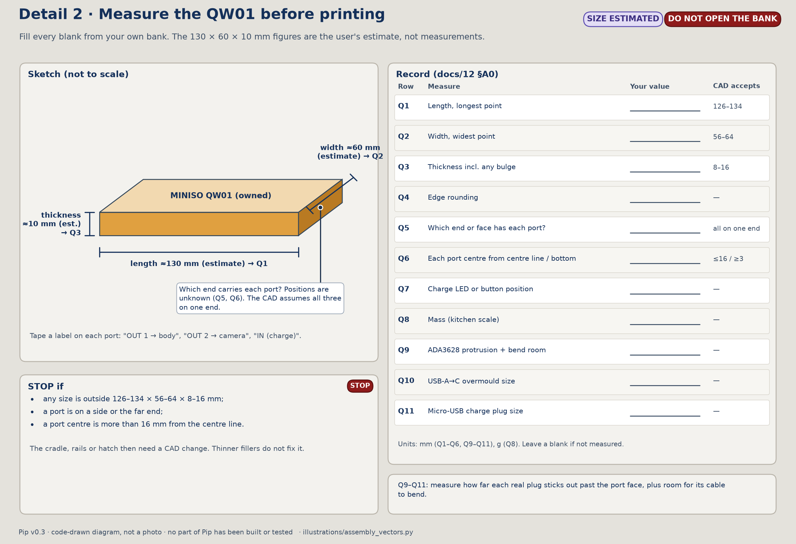

The CAD uses placeholder sizes for every bought part. Measure before printing the full set to avoid reprints. The earlier 0.6 kg filament figure is an estimate, not a slicer result.

**Parts:** every bought or owned part in hand. **Tools:** calipers, scale, masking tape.

### 2a. The QW01 first

Follow [12](12-measurement-calibration-checklist.md) §A0, rows Q1–Q11. Measure the bank in its case. Do not open it.

1. Measure length, width and thickness at the largest points, including any bulge (Q1–Q3).
2. Note which end or face carries each port. The CAD **assumes** both USB-A outputs and the micro-USB input are on the same end (Q5). Label each port with tape: "OUT 1 → body", "OUT 2 → camera", "IN (charge)".
3. Measure each port centre from the bank's centre line and from its bottom face (Q6).
4. Note the charge LEDs and any button (Q7). Weigh the bank (Q8).
5. Measure the plugs you will actually use: how far each sticks out past the port face, plus room for the cable to bend (Q9–Q11).

**STOP if:**

- any size is outside 126–134 × 56–64 × 8–16 mm;
- a port is on a side or the far end;
- a port centre is more than 16 mm from the centre line.

The cradle, rails or hatch then need redesigning ([12](12-measurement-calibration-checklist.md) §A0). Thinner fillers do not fix this.

### 2b. Other parts, as they arrive

Use [12](12-measurement-calibration-checklist.md) §A. The table shows which printed parts each measurement affects. Hold those prints until the row is done.

| Measure | Rows in 12 | Hold these prints |
|---|---|---|
| QW01 and its plugs | Q1–Q11 | tray, bank_shim_L/R, bank_front_spacer, rear_shell, rear_hatch |
| TT motor: body, shaft, shaft flats | E3 | base_plate, drive_wheel_L/R, motor_strap |
| FS90 servo: body, tabs, spline, horn | E4 | top_deck, clutch_disc |
| Kitronik 5331 + Pico: holes, height, **switch position and travel** | E5 | rear_upright, rear_shell, switch_actuator |
| PiicoDev Buttons: **hole positions**, cap height | E6 | rear_upright, plunger_wake, plunger_move |
| DFR1154: **lens position**, mic position, USB-C position, rear components | E7 | head_base, head_cap, eye_left_camera |
| Supplied speaker: size and plug | E9 | head_base, head_cap |
| USB-C plug overmould | E10 | top_deck, head_base |
| Other PiicoDev modules | E12 | front_shell, base_plate |
| Your M3 / M2.5 screws | E14 | all parts with pilot holes |

**Speaker (STOP for the head base).** The CAD speaker is 30 × 20 × 5 mm. That was the earlier Adafruit placeholder, not the speaker DFRobot supplies. Measure the supplied speaker and enter its size in `Boards.spk_l`, `spk_h` and `spk_t` in [`params.py`](../cad/pip_robot/params.py). Check that its plug fits the DFR1154 socket. Then regenerate the speaker cradle. If the speaker does not fit the head's space, the CAD needs changing before head_base is printed.

**Checkpoint:** every row you can measure is filled in [12](12-measurement-calibration-checklist.md). Unmeasured rows are marked as such.

---

## Stage 3 — Print and test the fit coupon

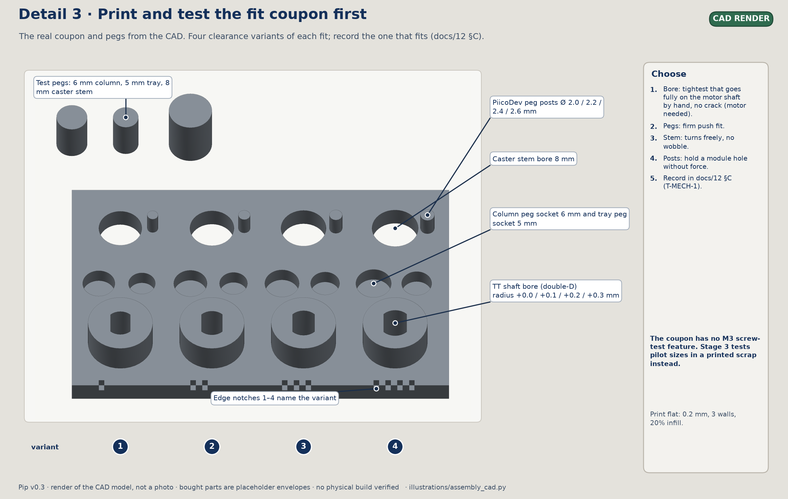

The coupon is a small plate with four clearance variants of each important fit. It shows how your printer's holes and pegs come out.

**Parts:** `fit_test_coupon.stl`, `fit_test_pegs.stl`. **Tools:** calipers, a TT motor (if bought), screws, drill or pin vice.

1. Print both files flat, 0.2 mm layers, 3 walls, 20% infill. The notches on the coupon edge (1 to 4) identify the variants.
2. **TT shaft bore** (+0.0 / +0.1 / +0.2 / +0.3 mm): push the motor shaft into each bore. Choose the tightest one that goes fully on by hand without cracking. You need a motor in hand for this check.
3. **Column peg (6 mm) and tray peg (5 mm):** try the printed pegs. Choose a firm push fit.
4. **Caster stem (8 mm):** the stem must turn freely with no wobble.
5. **PiicoDev peg posts** (Ø 2.0 / 2.2 / 2.4 / 2.6 mm): choose the one that holds a module's mounting hole without forcing it.
6. **M3 pilot:** drill test holes at 2.4, 2.5 and 2.6 mm in a printed scrap and drive one of your screws into each. Choose the size where the screw goes in firmly and holds without splitting the plastic. The coupon has no screw test feature yet.
7. Record the choices in [12](12-measurement-calibration-checklist.md) §C (test T-MECH-1).

**Checkpoint:** §C clearance rows are filled in. The hatch-ledge and column-jog rows are done later, on the real parts.

---

## Stage 4 — Update the CAD and print the parts

**Before the full print:** clear the motor/wheel insertion-path STOP in Stage 5, measure bought parts in Stage 2 and resolve each affected mount. The table is the intended print set after those checks. While they remain open, print only the calibration coupon and specifically approved fit sections or bank-fit pieces.

1. Enter the measured values in [`params.py`](../cad/pip_robot/params.py). Each row in [12](12-measurement-calibration-checklist.md) names its parameter. Coupon results go in `Print.clearance` and `M3_PILOT_R` in `parts.py`.
2. Run `scripts/cad.sh --bank-fit-only`. Fix anything it reports before continuing.
3. Run `scripts/cad.sh`. Read `cad/out/validation_report.md`. Every check must pass.
4. Print in the order below. That way, early prints can show problems before the large parts are committed.

| Order | STL (in `cad/out/stl/`) | Qty | Colour | Layer / walls / infill | Orientation |
|---|---|---|---|---|---|
| 1 | fit_test_coupon, fit_test_pegs | 1 + 1 | any | 0.2 / 3 / 20% | flat (Stage 3) |
| 2 | tray | 1 | grey | 0.2 / 3 / 25% | upside down, rails on the bed |
| 2 | bank_shim_L, bank_shim_R | 1 each | grey | 0.2 / 100% | as exported |
| 2 | bank_front_spacer | 1 | grey | 0.2 / 100% | as exported |
| 3 | base_plate | 1 | grey | 0.2 / 4 / 30% | flat; support only under the caster-tower roofs |
| 3 | motor_strap | 4 | grey | 0.2 / 3 / 50% | as exported |
| 3 | drive_wheel_L, drive_wheel_R | 1 each | dark | 0.2 / 4 / 40% | outer face down |
| 3 | caster_fork_F, caster_wheel_F | 2 each | grey / dark | provisional 0.2 / 4 / 40% | as exported; inspect overhangs and free rotation in the slicer |
| 3 | caster_axle_F, caster_clip_F | 2 each | grey | provisional 0.12 / 4 / 100% | as exported; check split-tip strength on a spare before assembly |
| 4 | column_L (used for both sides) | 2 | grey | 0.2 / 5 / 50% | lying down, jog flat on the bed |
| 4 | rear_upright | 1 | grey | 0.2 / 3 / 25% | flat |
| 4 | top_deck | 1 | grey | 0.2 / 4 / 30% | deck down; check the servo-ledge bridges |
| 5 | head_base | 1 | grey | 0.2 / 3 / 25% | skirt down; supports under floor overhang, hooks and cradle |
| 5 | head_cap | 1 | white | 0.2 / 3 / 15% | open side down; tree supports |
| 5 | eye_left_camera, eye_right | 1 each | black | 0.12 / 3 / 100% | as exported |
| 5 | clutch_disc | 1 (+ 2 variants) | grey | 0.12 / 3 / 100% | flat |
| 6 | front_shell, rear_shell | 1 each | white | 0.2 / 3 / 15% | seam face down; tree supports |
| 6 | rear_hatch | 1 | white | 0.2 / 4 / 30% | pod face down; support under the tongues |
| 6 | plunger_wake (white), plunger_move (dark) | 1 each | as named | 0.12 / 100% | as exported |
| 6 | switch_actuator | 1 | dark | 0.12–0.2 / 100% | as exported (see the STOP in Stage 12) |

Settings follow [11](11-mechanical-design-print-assembly.md) §7, with provisional caster settings added here. "As exported" describes orientation only. STL files contain no layer, wall or infill settings. Keep the orientation each file loads in, then inspect the sliced layers and supports. No slicer has been run, so print times and support amounts are unknown. Bounding boxes fit a 220 × 220 × 250 mm build volume. The base plate, tray and both shells do not fit a 180 mm bed. Splitting them needs joining features and strength checks before use.

**Checkpoint after the print prerequisites are cleared:** all 36 pieces are printed, supports removed, holes cleaned. Each part is labelled. Until then, record only the calibration or fit pieces actually printed.

---

## Stage 5 — Drive base: motors, wheels and casters

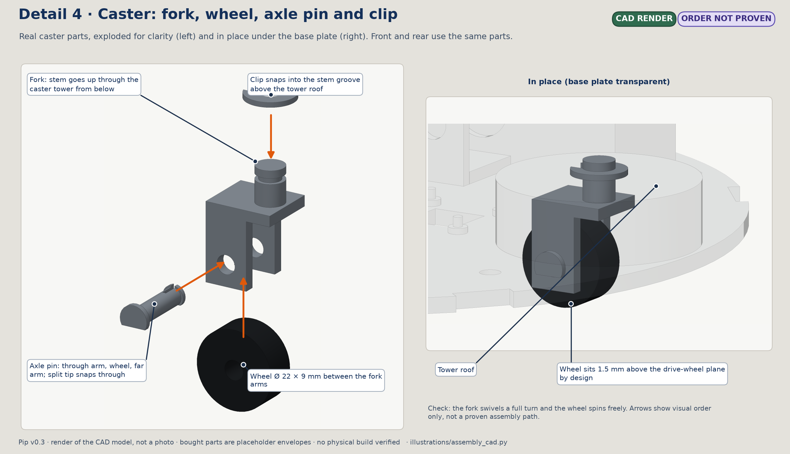

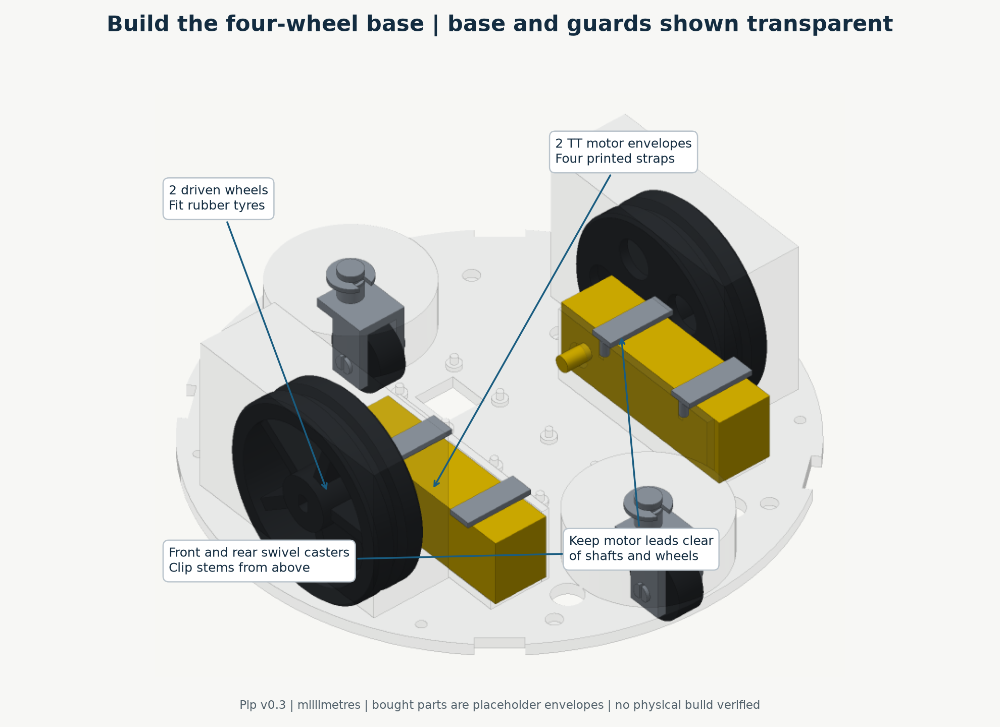

**Parts:** base_plate, 2 TT motors, 4 motor_strap, drive_wheel_L/R, 2 tyres, 2 each of caster fork / wheel / axle / clip. Colour and accelerometer PiicoDev modules. **Tools:** none beyond fingers. Deburring tool if a fit is tight.

> **STOP: prove the motor and wheel insertion path first.** Each motor sits between walls with closed shaft holes. Each wheel sits in a roofed guard well. The parent review's [sampled insertion check](../cad/check_assembly_paths.py) finds collisions for a straight motor drop and a lateral wheel press. This does not rule out every oblique or combined path. Prove a complete sequence in CAD and with a small fit section before printing the full base. Do not force, bend or cut the guards to follow the instructions below. Steps 3–6 describe final placement, not an approved insertion sequence.

1. **Base modules.** Press the colour sensor onto the four peg posts at the front centre, sensor facing **down** through the square window. Press the accelerometer onto the posts behind it. These are covered by the tray later, so fit them now.
2. **Casters (×2, same part front and rear).** Put a caster wheel between the fork arms. Push an axle pin through the arm, the wheel and the far arm until its split tip snaps through. Feed the fork's stem up through the caster tower from below. Snap a caster clip into the stem groove above the tower roof. The fork must swivel freely and the wheel must spin.
3. **Motors.** Seat each TT motor in its cradle with the shaft at the wheel axis. Feed its leads toward the rear cable-pass holes (near the back of the plate, either side of centre). Keep the leads clear of the shafts.
4. **Motor straps.** Put two straps over each motor: peg into the cradle-wall hole, tongue into the guard-wall slot. The straps only clamp properly once the tray is on (Stage 6).
5. **Tyres.** Stretch an O-ring or rubber band into each wheel's groove.
6. **Wheels.** Press each wheel onto its motor shaft (left wheel on the robot's left, +Y). The outer guard wall allows about 4 mm of sideways play.

**Checkpoint:**

- Casters swivel through a full turn and touch nothing.
- Both wheels turn by hand with the motors unpowered. (The gearbox resists; that is normal.)
- Neither wheel slips on its shaft (T-MECH-2).
- Motor leads are not pinched.
- On a flat table the base rests on both drive wheels and one caster. The casters sit 1.5 mm above the drive-wheel plane by design.

---

## Stage 6 — Columns, bank straps, tray and rear upright

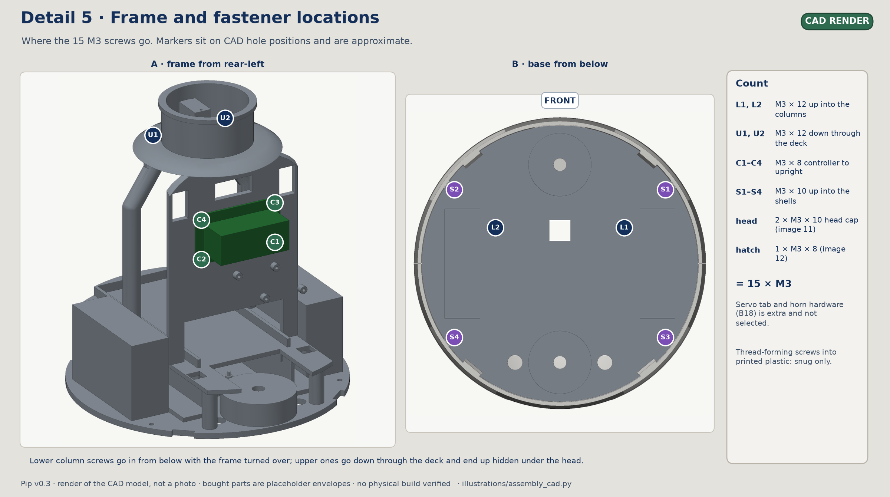

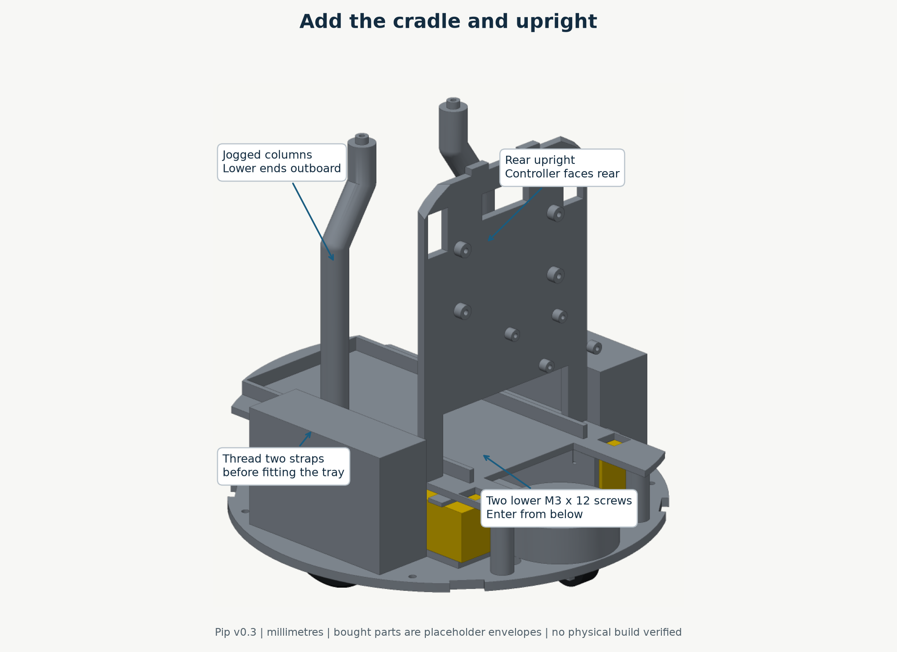

**Parts:** 2 × column, 2 hook-and-loop straps, tray, rear_upright, **2 × M3 × 12**. Use the same column STL twice. Keep the lower peg down and rotate the second column 180° about the vertical axis so its jog leans inward on the other side. **Tools:** screwdriver.

1. **Columns.** Push each column's lower peg into its base socket, beside where the bank will sit. The jog must lean **inward** going up, toward the robot's centre line. The upper ends finish at the deck sockets, about 27 mm either side of centre.
2. **Lower frame screws.** Turn the base over, supporting the columns. Drive one M3 × 12 up through the base plate into each column. Snug only; the screw threads into plastic.
3. **Straps before tray.** Thread both straps through the tray's slots beside the rails, so each strap runs under the tray and up the far side. They cannot be threaded once the tray is down.
4. **Tray.** Lower the tray over the columns and push its four legs into the base sockets. It sits on top of the motor straps and holds them down.
5. **Rear upright.** Push the upright's two bottom legs into the tray sockets at the rear. The opening at the bottom of the upright (the "arch") is where the bank's port end will pass. The top tabs locate in the deck in Stage 8. Until then the upright is loose, so handle it gently.

**Checkpoint:**

- Both columns are upright and firm, with screw heads flush under the base.
- The tray sits flat with all four legs home, and both straps slide freely.
- The motors can no longer lift out of their cradles.
- Load test (from [12](12-measurement-calibration-checklist.md) §C, column jog): once the deck is on in Stage 8, lift the frame by the deck and check for any visible bend at the jogs.

---

## Stage 7 — Controller and rear buttons (mechanical only)

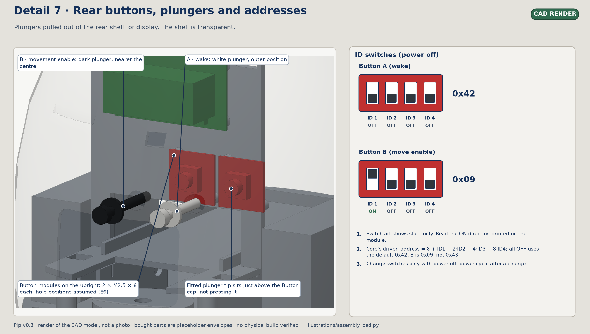

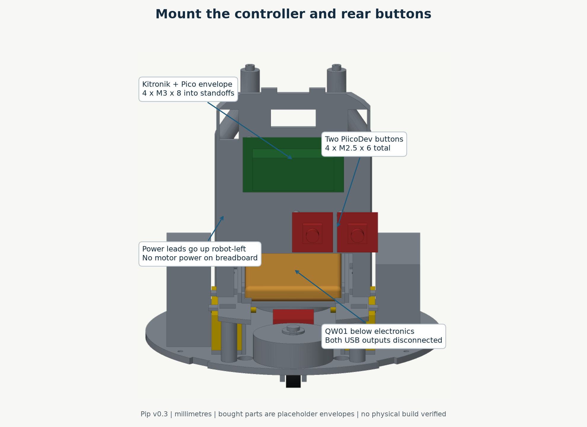

**Parts:** Kitronik 5331 with the Pico 2 WH seated, 2 PiicoDev Buttons, **4 × M3 × 8**, **4 × M2.5 × 6**. **Tools:** screwdriver.

1. With all power removed, match the Pico's orientation to the Kitronik board's Pico outline and manufacturer instructions. Check both rows of header pins enter the matching sockets without an offset. Press evenly without bending pins. Check the controller holes line up with the four upright standoffs, row E5. If the orientation or holes are unclear, **STOP**.
2. Screw the controller to the rear face of the upright with 4 × M3 × 8, **Pico side facing the rear**.
3. Fit the two Buttons on the robot's right side (−Y), low on the upright, with 2 × M2.5 × 6 each. **Button A (wake)** is the outer one, behind the white plunger. **Button B (movement enable)** is nearer the centre, behind the dark plunger. The hole positions are assumed (row E6). If they do not line up, **STOP**.
4. Set the Button ID switches with power removed, before mounting: A all OFF gives 0x42; B switch 1 ON and 2–4 OFF gives 0x09. Follow the photos-and-log procedure in [16](16-wire-by-wire-assembly.md) Stage 5. This method needs no solder. The addresses still need a later scan to confirm no clashes.

**HOLD:** do not connect any wire to the Kitronik terminals. The connection list in [04](04-wiring-pin-plan.md) §5 is not cleared for assembly.

**Checkpoint:** board and Buttons are firm. The Pico's USB socket can be reached from behind. Nothing is wired.

---

## Stage 8 — Top deck, upper frame screws and servo seat

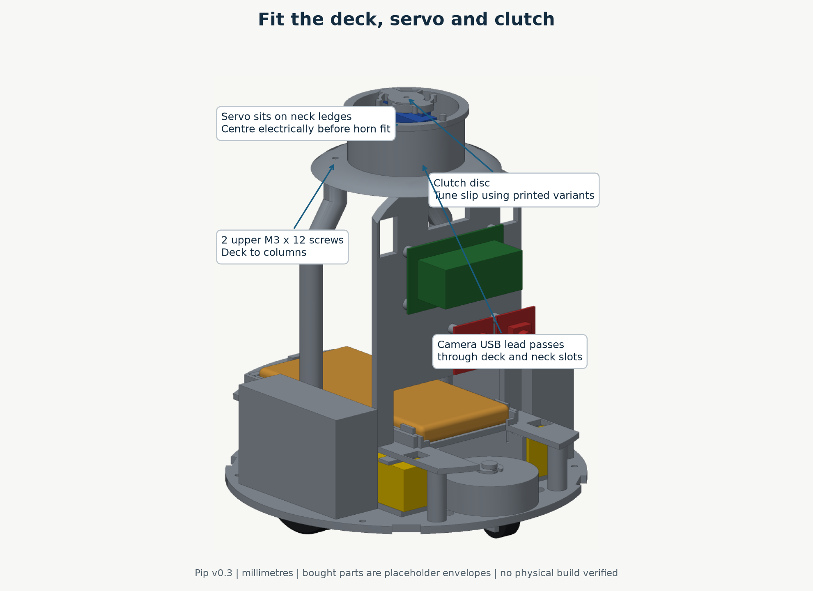

**Parts:** top_deck, FS90 servo, clutch_disc (plus the 1.2 and 2.0 mm variants if printed), **2 × M3 × 12**. **Tools:** screwdriver.

1. **Deck.** Lower the deck onto the two column tops and the upright's two tabs. Drive an M3 × 12 down through the deck into each column top. These screws end up hidden under the head, so the head must come off to reach them later.
2. **Servo dry seat.** Lower the FS90 into the neck sleeve so its mounting tabs rest on the two ledges. Feed its lead down through the small slot in the deck beside the servo body. The ledges have provisional 1.8 mm pilot holes. **STOP before final fastening:** measure the actual tab holes and ledges, confirm supplied screws, and select screw diameter and length with tips clear of the servo case and cable. Record the tab and horn hardware under B18. It is not included in the 15 M3 screw total.
3. **Camera lead path.** Note the curved slot on the robot's left (+Y) side of the deck, inside the neck. The camera's USB-C lead goes through it in Stage 11.

> **HOLD — servo centring is a gated electrical step.** The horn must go on the servo spline while the servo is held at its electrical centre by a control signal. That needs a powered servo branch (gate PG2) and firmware, and neither exists. **Do not turn the servo output shaft by hand to find centre.** Forcing it can strip the plastic gears. Leave the horn off the spline for now.

4. **Clutch disc dry fit.** Press the servo horn into the pocket on the underside of the clutch disc. Set the pair aside, **not** on the servo. Note which clutch variant (1.2 / 1.6 / 2.0 mm arm) you are using. Choosing between them happens in Stage 17.

**Checkpoint:**

- The deck is firm on both columns and both upright tabs.
- The servo sits level on its ledges, and its lead is through the deck.
- The horn is **not** fitted to the spline.
- Lifting the frame by the deck shows no bending at the column jogs ([12](12-measurement-calibration-checklist.md) §C).

---

## Stage 9 — Bank fillers and retention (bank disconnected)

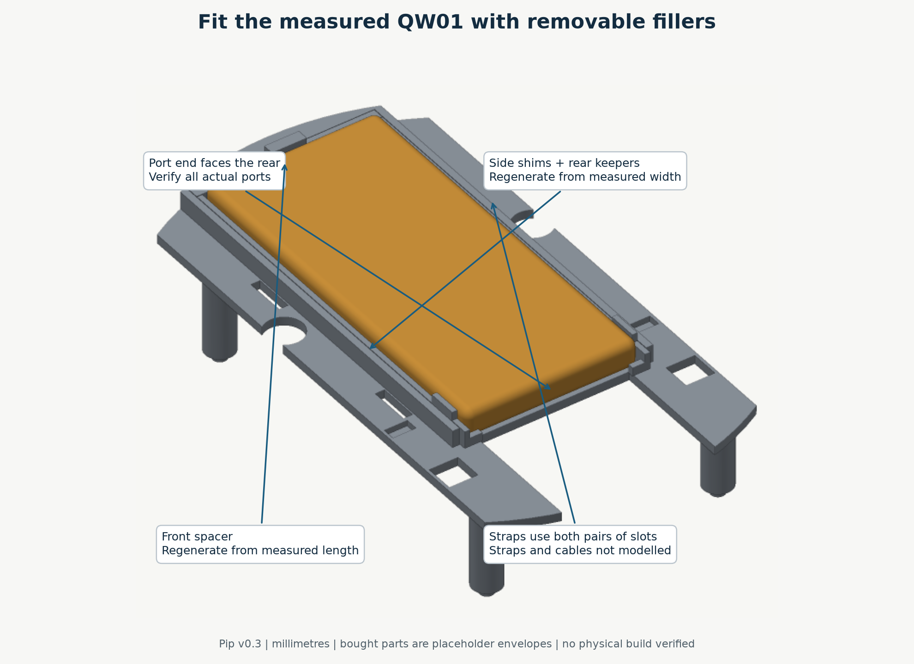

Do this only after Stage 2a is complete and the fillers have been regenerated from the measured size.

**Parts:** QW01 (nothing plugged in), bank_front_spacer, bank_shim_L/R, the two straps from Stage 6. **Tools:** none.

1. Leave both shells off.
2. Stand the **front spacer** against the tray's front wall.
3. Hold the bank with its port end toward the rear. Angle the port end under the upright's arch, set the bank on the tray floor, and slide it forward until its front touches the spacer.
4. Drop a **side shim** into the gap on each side, between the bank and the rail. The small **keeper** at the rear end of each shim must hook behind the bank's rear corner. If a port turns out to be within about 13 mm of a side edge, trim that keeper off and rely on the straps ([12](12-measurement-calibration-checklist.md) §A0).
5. Pull both straps over the bank and close them firmly, without crushing the case.

**Fit trial** ([12](12-measurement-calibration-checklist.md) Q12–Q16; tests T-MECH-6 and T-MECH-7):

| # | Check |
|---|---|
| Q12 | Bank drops in without force and cannot rock. The port end sits at the rear edge of the rails |
| Q13 | With straps closed, the bank does not move when the frame is tilted 30° each way and pushed firmly |
| Q14 | Through the hatch opening (once the rear shell is on, Stage 13), both output plugs come out by hand and the micro-USB plug goes in, without touching the shell |
| Q15 | The hatch closes over both fitted output plugs without pressing on them |
| Q16 | Leads can route up the robot's left side behind the upright, clear of the plungers on the right |

For Q14 and Q15, use the plugs with **nothing connected at their far ends**. The ADA3628 terminal block must have no wires in it. Keep it away from metal, and unplug every plug straight after the check. Do not leave leads plugged into the bank.

**Checkpoint:** Q12 and Q13 pass and are recorded. Q14–Q16 are recorded after Stage 13. The bank is left unplugged.

---

## Stage 10 — Head: eyes, camera and speaker

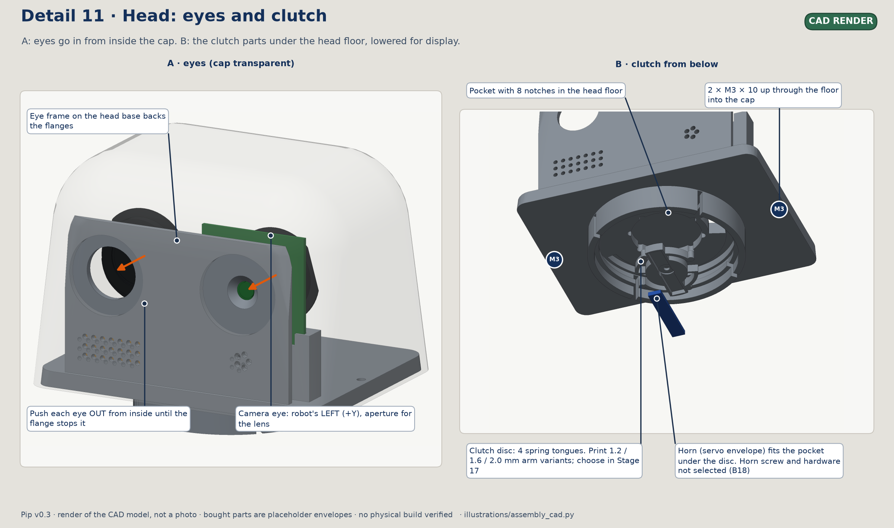

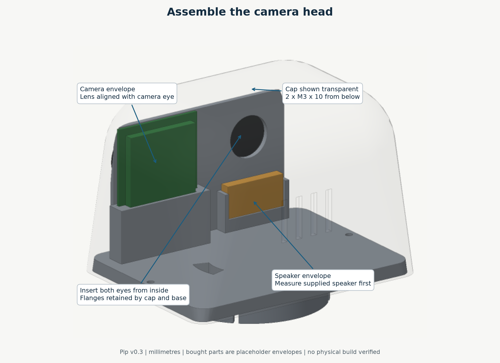

**Parts:** head_cap, head_base, eye_left_camera, eye_right, DFR1154 camera board, the speaker supplied with it, the USB-C lead from the in-line switch cable, **2 × M3 × 10**. **Tools:** screwdriver.

1. **Eyes.** From **inside** the cap, push each eye out through its socket until the flange stops it. The camera eye goes on the robot's left (+Y), which is the viewer's right when facing Pip. Once the cap is on the base, the eye frame behind the flanges stops the eyes being pushed in.
2. **Camera board.** Slide the DFR1154 down into the cradle behind the left eye, lens toward the eye. Check that the lens lines up with the eye aperture. The CAD assumes the lens is at the board centre (row E7). If the measured lens is off-centre, **STOP** and regenerate head_base and the eye first.
3. **Speaker.** Slide the supplied speaker into the rails behind the right eye's grille. **STOP** if the head base was printed from the 30 × 20 × 5 mm placeholder and the real speaker is a different size (Stage 2b).
4. **Unpowered cable fit.** Plug the speaker into the camera board's speaker socket. Plug the USB-C lead's male end into the camera board, and feed the cable down through the head-floor slot. The other end of this lead must **not** be connected to anything.
5. **Close.** Lower the cap onto the base. Drive 2 × M3 × 10 up through the head floor into the cap bosses.

**Checkpoint:**

- Neither eye moves when pushed or pulled by hand.
- The lens looks straight out of the left eye.
- The speaker is held in its rails.
- The USB-C lead leaves the head floor without a sharp bend.

---

## Stage 11 — Head onto the neck (dry fit)

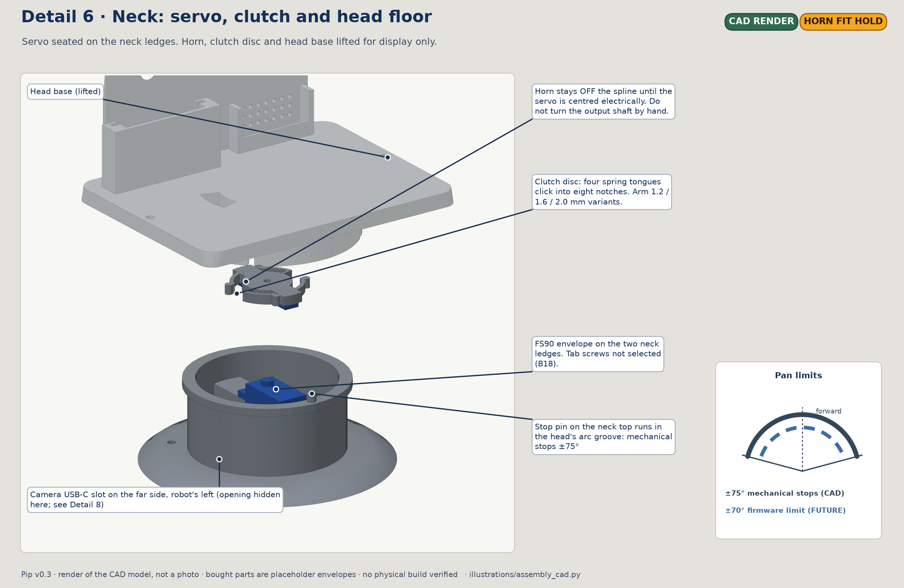

**Parts:** assembled head, clutch disc with horn (from Stage 8). **Tools:** none.

1. Feed the head's USB-C lead down through the neck and the curved deck slot on the robot's left. Leave a service loop of about 60 mm in the head and about 80 mm in the body ([04](04-wiring-pin-plan.md) W15).
2. Put the clutch disc in the head floor's pocket so its spring tongues click into the notches. The horn stays **off** the servo spline (Stage 8 HOLD).
3. Lower the head onto the neck. The stop pin at the rear of the neck top should run in the arc groove under the head. The four snap hooks clip under the neck flange.
4. Turn the head slowly by hand from stop to stop (about ±75°). With the horn off the spline, you are turning the head on the neck, not driving the servo.

> **Hooks.** Once the shells are on, the snap hooks are hidden and only an adult with the shells off can release them. Snap them only when you are ready. If they need heavy force to snap or release, **STOP** and report rather than cracking a hook.

**Checkpoint:**

- The head turns smoothly to both stops with no rubbing.
- The USB-C lead does not tighten at either stop.
- An 8 mm finger probe finds no closing gap at the neck (T-SAF-8).

**Later (HOLD/FUTURE):** once the servo is centred electrically, lift the head off, fit the horn onto the spline with the head facing straight forward, and refit. Then re-check the stops.

---

## Stage 12 — Shell modules, plungers, switch actuator and cable routing

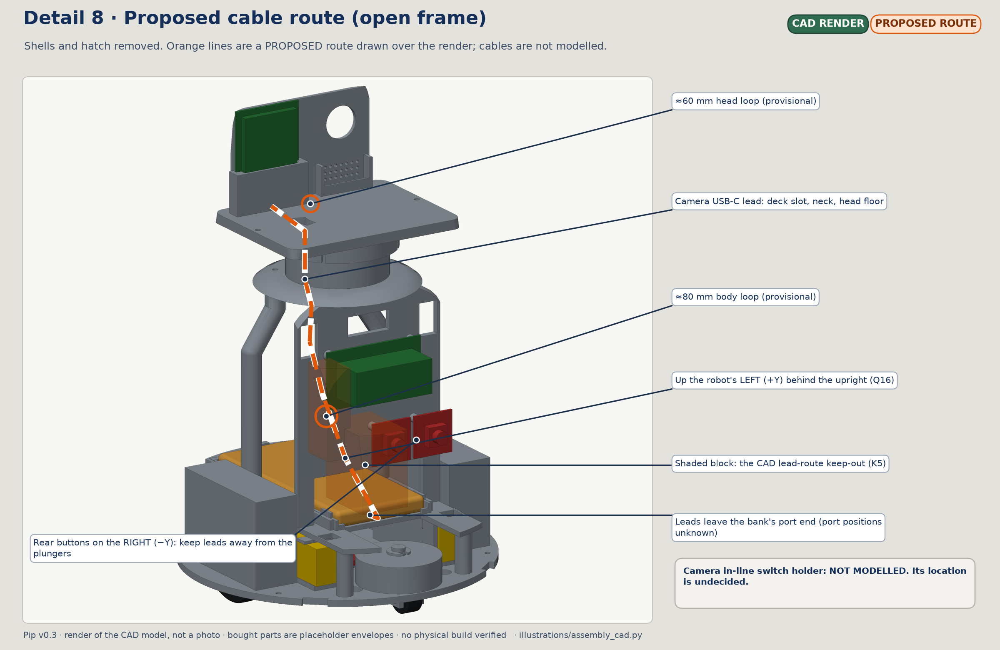
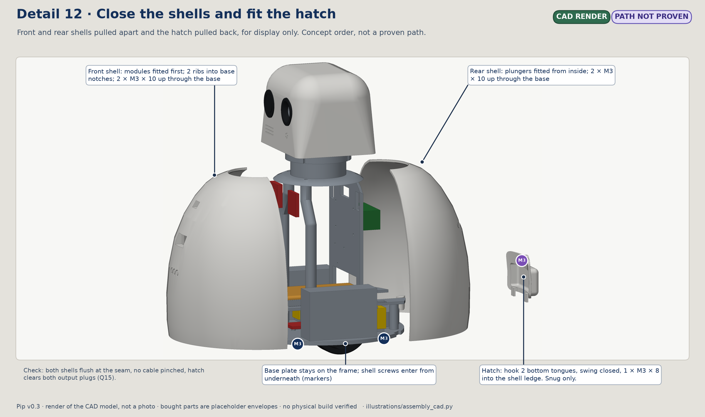

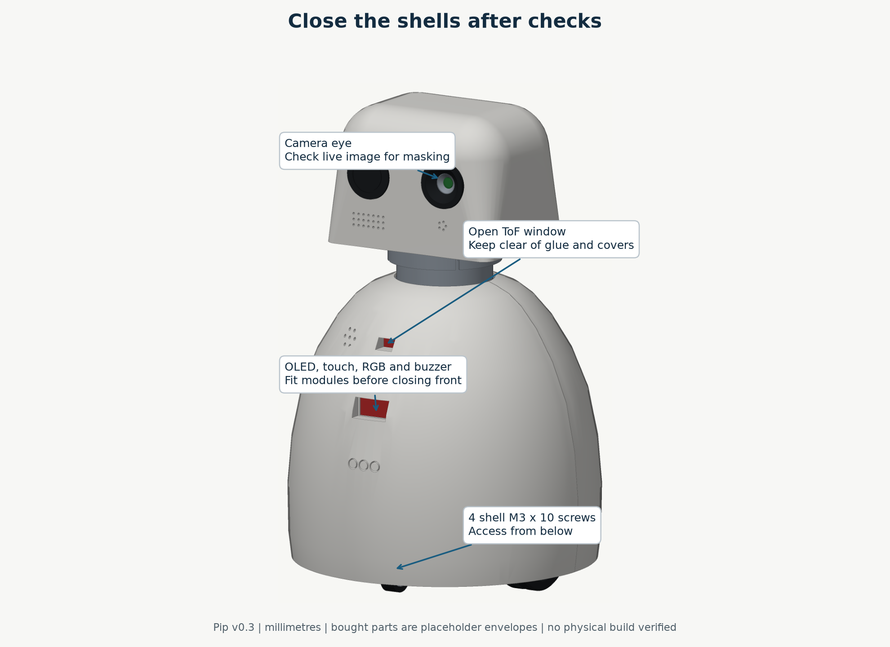

**Parts:** front_shell, rear_shell, OLED, touch, ToF distance, RGB LED and buzzer modules, PiicoDev cables, plunger_wake (white), plunger_move (dark), switch_actuator, **4 × M3 × 10**. **Tools:** screwdriver. Hot glue is allowed for a loose module; it is not soldering.

### Front shell

1. Press each module into its pocket from inside:

   | Module | Position on the front | Detail |
   |---|---|---|
   | OLED | Belly window | Glass in the glass pocket |
   | Touch | Below the OLED | Behind the 1.0 mm membrane with three target rings |
   | ToF distance | Chest | Behind the open window; **keep the window clear** of glue, tape or covers |
   | RGB LED | Left cheek | Behind the thin white diffuser |
   | Buzzer | Right cheek | Behind the holes |

2. Plug the front modules into one chain with PiicoDev cables, following [04](04-wiring-pin-plan.md) §6 and [16](16-wire-by-wire-assembly.md) Stage 6. Cable C5 from the colour module to touch is the front-shell disconnect. A 200 mm cable is planned; choose the shortest owned cable that reaches with slack and allows removal. **HOLD:** nothing connects to the Kitronik terminals and nothing is powered. This step only checks that the cables reach.
3. **Not modelled:** the atmospheric sensor has no mount in v0.3 ([04](04-wiring-pin-plan.md) §6 places it on the upright near the vents). Leave it out until a mount exists.
4. Seat the front shell's two ribs in the base notches. Turn Pip over and drive 2 × M3 × 10 up through the base into the shell bosses.

### Rear shell

5. Push each plunger out through its hole from inside, white (A, wake) on the outer button position and dark (B, move) nearer the centre. The inner collar keeps it in once the shell is fitted.
6. **Switch actuator — STOP until the board switch is measured** (row E5). The actuator is a concept part that assumes the switch slides sideways. If the measured switch differs, the actuator and its shell slot must be redesigned before printing.
7. Trial-route the unpowered leads up the robot's **left** side behind the upright, clear of the plungers on the right. The camera's in-line switch holder is **not modelled**. Leave that switch out of the completed assembly until a secure holder and strain relief exist. A loose switch is acceptable only during this unpowered fit trial.
8. Seat the rear shell's ribs. Check that each plunger tip sits just above its Button cap and is not pressing it. Drive 2 × M3 × 10 up through the base.

**Checkpoint:**

- Both shells are flush at the seam.
- All four shell screws are in.
- Each plunger clicks its Button and springs back.
- No cable is pinched at the seam or the base.
- Shells come off and go back on in under 3 minutes with one screwdriver (T-MECH-3).

---

## Stage 13 — Rear hatch

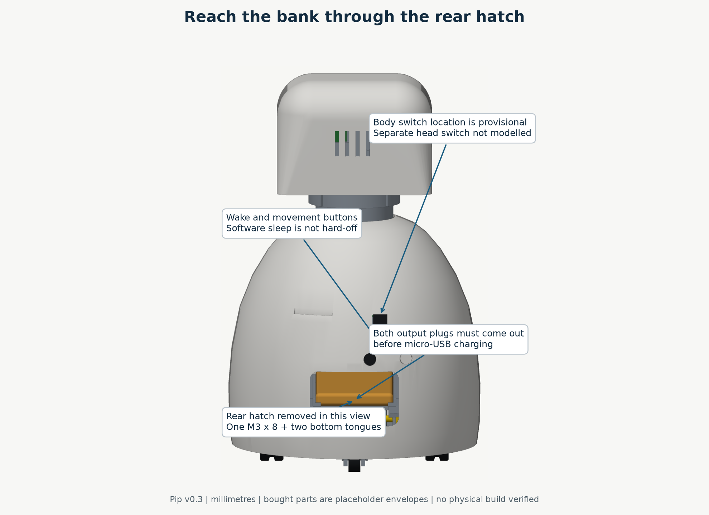

**Parts:** rear_hatch, **1 × M3 × 8**. **Tools:** screwdriver.

1. Hook the hatch's two bottom tongues in behind the shell edge.
2. Swing the top closed.
3. Drive the M3 × 8 through the counterbore into the shell ledge. Stop as soon as it is snug; the ledge is printed plastic.
4. Complete fit-trial rows Q14–Q16 from Stage 9.
5. Remove and refit the hatch 10 times. The screw must still hold ([12](12-measurement-calibration-checklist.md) §C, hatch ledge).

**Checkpoint:** the hatch closes flush, does not press on plugs (Q15), and survives 10 cycles. The mechanical dry build is complete. The bank is still unplugged.

---

## Stage 14 — Power-off connection verification (HOLD)

*Wire colours and GPIO labels are shown. Physical terminal order comes from the delivered board.*

**HOLD.** The body branch is not cleared for assembly ([05](05-power-budget-charging.md) §3–4). This stage lists what must be true before any wire is connected. It is not an instruction to wire now.

Use the [wire-by-wire tutorial](16-wire-by-wire-assembly.md) for terminal identification, W1–W17, C1–C9, strip lengths, tool selection and log sheets. It separates unpowered fit checks from blocked electrical assembly.

Before any wiring session:

- [ ] A protected body-branch power design is selected and documented, and the applicable paper prerequisites and bench plan are approved. Measured gates run during the approved bring-up ([05](05-power-budget-charging.md) §4–5).
- [ ] The connection list in [04](04-wiring-pin-plan.md) §5 is updated for that design and marked as cleared.
- [ ] Every terminal label, polarity mark and connector on the parts **as delivered** has been checked against that list. Do not rely on listing photos.
- [ ] Both bank leads are unplugged and the body switch is off.
- [ ] No motor or servo current runs through GPIO pins, PiicoDev cables or signal jumpers. PiicoDev modules use their own 3.3 V supply leg, subject to PG6 ([04](04-wiring-pin-plan.md) §2).
- [ ] No added wire or Y cable joins the two USB outputs. Their internal connection in the bank is unknown.
- [ ] Each connection is photographed and checked against the list by a second person.

**Checkpoint:** a signed record that every box is ticked. Until then, stop here.

---

## Stage 15 — Gated bench bring-up (HOLD)

When Stage 14 is complete, bring-up follows [09](09-build-plan-milestones-tests.md) §2. The order is:

1. visual check;
2. polarity and continuity with the power off;
3. power on with the wheels off the ground;
4. run the smallest test;
5. log the result;
6. only then add the next subsystem.

| Step | Needs first | Status |
|---|---|---|
| Meter the body supply with only the adapter connected ([16](16-wire-by-wire-assembly.md) Stage 13) | Approved protected design and bench plan; documented bank limits | Blocked |
| Controller-only bring-up, motors disconnected | Above + approved safe-boot diagnostic; measure PG6/PG7 as applicable | Blocked |
| PiicoDev bus scan | Above + bus interface plan, GP0/GP1 diagnostic code; verify PG6 | Blocked |
| Servo connected; supply checked during head motion | Selected harness, pinout and approved PG2/PG3 test plan; record PG2 result | Blocked |
| Camera branch connected; supply checked under video and audio | Known branch ratings and approved PG4 test plan; record PG4 result | Blocked |
| Driving on the floor | All PG gates, T-SAF tests | Blocked |

Do not test past any component's known rating to find its limit, and do not stall the motors by hand ([05](05-power-budget-charging.md) §5).

---

## Stage 16 — Firmware and laptop commissioning (FUTURE)

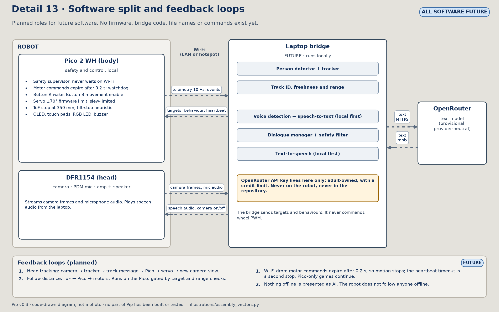

**FUTURE.** Pip application firmware and bridge software have not been implemented. The reference address-scan snippet in [16](16-wire-by-wire-assembly.md) is a separate, unrun diagnostic example. Initial Pico programming uses the standalone setup in that guide; USB power does not clear any robot power gate.

The software that has to be written and tested ([02](02-architecture.md), [03](03-ai-camera-audio-feasibility.md)):

- Pico supervisor firmware:
  - motor commands that expire after 0.2 s;
  - hardware watchdog;
  - movement enable cleared at boot;
  - Button A/B state machine;
  - servo slew limit and ±70° limit;
  - tilt heuristic and ToF stop.
- A servo-centring routine. Stages 8 and 11 need it to fit the horn.
- DFR1154 firmware for camera streaming, microphone and speaker playback.
- The laptop bridge: tracking, speech, AI provider link with an adult-owned key and a credit limit.
- Scanned address confirmation for both PiicoDev Buttons after the physical switch settings in Stage 7.

The AU$0 bench loops in [09](09-build-plan-milestones-tests.md) M0 use owned kit parts on the kit's own board. They can start independently of this build.

---

## Stage 17 — Calibration and tests

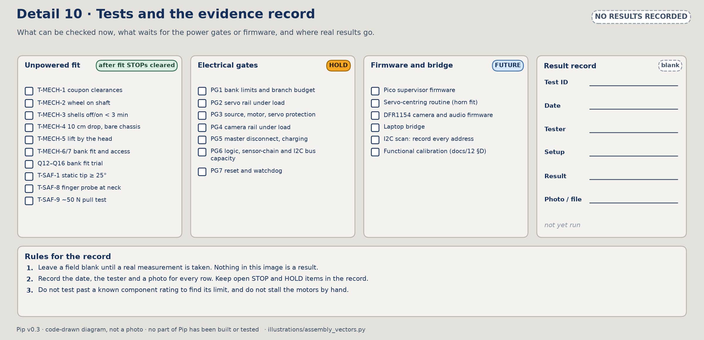

Result columns stay blank until a real measurement is taken ([09](09-build-plan-milestones-tests.md) §3).

**Possible now (mechanical, unpowered):**

| Test | What |
|---|---|
| T-MECH-1 | Coupon clearances (Stage 3) |
| T-MECH-2 | Wheel on shaft: no slip, removable |
| T-MECH-3 | Shells off and on in under 3 minutes |
| T-MECH-4 | 10 cm drop of the bare printed chassis, with bank and electronics removed, no cracks |
| T-MECH-5 | Lift by the head with the motors off: deck and head stay on |
| T-MECH-6 / 7 | Bank fit and service access (Stages 9 and 13) |
| T-SAF-1 (static part) | Tilt table: static tip angle ≥ 25° each way, with the bank fitted. The tilt-stop part needs firmware |
| T-SAF-8 | 8 mm finger probe at the neck |
| T-SAF-9 | About 50 N pull on eyes, plungers, head and wheels: nothing comes off |

**After the gates and firmware (HOLD/FUTURE):** functional calibration in [12](12-measurement-calibration-checklist.md) §D. That covers wheel speed against PWM (the pulse setting that controls speed), servo centre and ±70°, clutch variant choice (T-PAN-2), camera bearing map, ToF offset, touch sensitivity and volume cap. It also includes every T-PWR, T-DRV, T-SAF (motion), T-PAN, T-CAM, T-AUD and T-AI test.

---

## Stage 18 — Charging and service

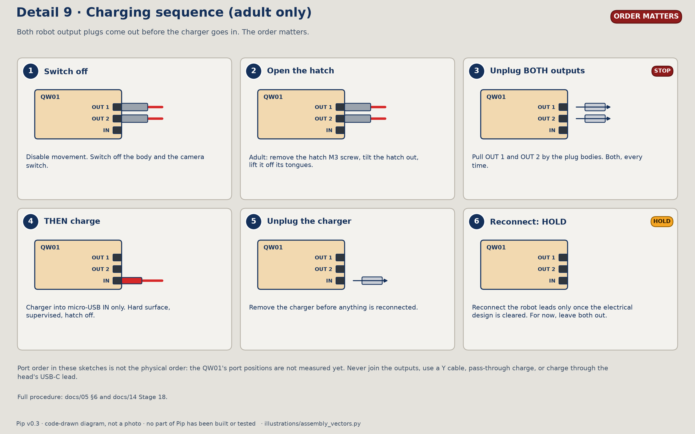

**Charging (adult only).** This assumes all ports face the rear hatch (Q5). Full procedure: [05](05-power-budget-charging.md) §6 and [11](11-mechanical-design-print-assembly.md) §2b.

1. Disable movement. Switch off the body and the camera switch.
2. Remove the hatch screw. Tilt the hatch out and lift it off its tongues.
3. Unplug **both** robot leads from the bank, pulling on the plug bodies.
4. Plug the charger into the bank's micro-USB input. Charge on a hard surface, supervised, with the hatch off.
5. Unplug the charger. Only after the electrical design is cleared, reconnect the two robot leads to their labelled ports. Route them up the left side and refit the hatch. During the current dry build, leave the robot leads disconnected.

**Bank removal:** remove the rear shell (2 screws under the base), unplug both leads, open both straps, then lift the bank up and back out.

**Reaching the deck screws or the servo:** remove both shells, release the head's snap hooks, and lift the head off.

---

## Stage 19 — Troubleshooting (mechanical)

| Symptom | Likely cause | Action |
|---|---|---|
| Wheel slips on its shaft | Bore too loose | Reprint with a tighter coupon variant |
| Wheel will not go on, or cracks | Bore too tight, or the insertion path is blocked (Stage 5 STOP) | Use a looser variant. If the path is blocked, report it; do not cut the guard |
| Caster does not swivel | Stem bore tight, clip too low, or support left in the tower | Clean the support; use a looser stem variant |
| Robot rocks on a flat floor | Normal: casters sit 1.5 mm high by design | None, unless a caster lifts the drive wheels |
| Tray will not sit flat | Strap bunched under a leg, or motor strap not seated | Re-thread the strap; reseat the motor straps |
| Column bends when lifting by the deck | Jog too weak | Reprint with more walls or infill; record the result |
| Screw spins without gripping | Pilot too large or stripped | Use the next pilot size down. Do not over-tighten printed threads |
| Bank rocks or slides | Fillers from the wrong size, or straps loose | Regenerate fillers from the measured size; re-tension the straps |
| Hatch presses on the plugs | Real plugs longer than modelled | Record plug lengths (Q9–Q11). A deeper pod or a right-angle adapter is a CAD change |
| Plunger does not click its Button | Button cap height differs (E6) | Re-measure and regenerate the plungers |
| Head rubs or sticks before a stop | Support left in the stop groove, or cable caught | Clean the groove; re-route the lead |
| Eye loose | Flange not fully behind the socket | Reseat the eye from inside the cap |

---

## Stage 20 — Evidence checklist

Keep these for the school record ([10](10-school-evidence-rubric.md)). Record only what was actually done and measured.

- [ ] Inventory with bought versus not-bought status (Stage 1)
- [ ] Filled [12](12-measurement-calibration-checklist.md) §A0 and §A tables, with photos of the calipers on the QW01
- [ ] Coupon photo and the chosen clearances (§C)
- [ ] The `params.py` changes and the regenerated `validation_report.md`
- [ ] One photo per stage, taken at its checkpoint
- [ ] Fit-trial results Q12–Q16
- [ ] Mechanical test results from Stage 17, with dates and the tester's name
- [ ] Open STOP and HOLD items, with what each is waiting for
- [ ] Gate records PG1–PG7. Leave blank until each is actually carried out
- [ ] Teacher review and consent records ([06](06-safety.md) §3). None are recorded yet

---

## Open prerequisites

| Item | Blocks | Where |
|---|---|---|
| QW01 measured; ports confirmed on one end | Tray, fillers, rear shell, hatch, Stage 9 | Stage 2a |
| Motor and wheel insertion path into the base | Stage 5 | CAD |
| Supplied speaker measured; cradle regenerated | head_base, Stage 10 | Stage 2b |
| Controller switch measured; actuator redesigned if needed | switch_actuator, rear_shell | Stage 12 |
| Atmospheric sensor mount | Stage 12 | CAD |
| In-line camera switch holder | Stage 12 routing | CAD |
| Servo tab and horn fastener selection, B18 | Final servo retention | Stage 8 |
| M3 pilot test piece on the coupon | Stage 3 step 6 | CAD (optional) |
| Protected body-branch power design; PG1–PG7 | Stages 14–15 | [05](05-power-budget-charging.md) |
| Firmware, servo centring routine, bridge | Stages 8 and 11 horn fit, 15–17 | Stage 16 |
| Purchase decision D1 | All bought parts | [00](00-status-assumptions-decisions.md) |

---

## Edit this guide

- **Text:** edit this file, `docs/14-illustrated-assembly-guide.md`. Keep one `## Stage N — Title` heading per stage, with Parts, Tools, Steps and Checkpoint inside it. Images use local relative links such as `images/assembly/01-drive-base.png`.
- **Original CAD images:** edit labels and viewpoints in `cad/assembly_guide_images.py`. Regenerate the eight images in `docs/images/assembly/` with `scripts/guide-images.sh`.
- **Additional diagrams and close-ups:** edit the [illustration sources](../illustrations/README.md), then run `scripts/illustrations.sh`. Vector diagrams have editable SVG copies beside their PNGs in `docs/images/wiring/` and `docs/images/assembly-detail/`. CAD close-ups are PNGs regenerated from editable Python layouts and the CAD source. Keep manual SVG variants under another name so regeneration cannot overwrite them.
- **Geometry:** dimensions, positions and part counts come from [`params.py`](../cad/pip_robot/params.py), `parts.py` and the registry in [`assembly.py`](../cad/pip_robot/assembly.py). When CAD changes, run `scripts/cad.sh`, `scripts/guide-images.sh` and `scripts/viewer.sh`. Update the matching numbers here and in [11](11-mechanical-design-print-assembly.md). If the guide and CAD disagree, stop and resolve the mismatch. A valid CAD model does not prove a part can be inserted or physically assembled.
- **Checks:** run `python3 scripts/check_docs.py` after editing. It checks local file links, image files, BOM arithmetic and viewer source freshness. It does not replace the physical checks in this guide.
