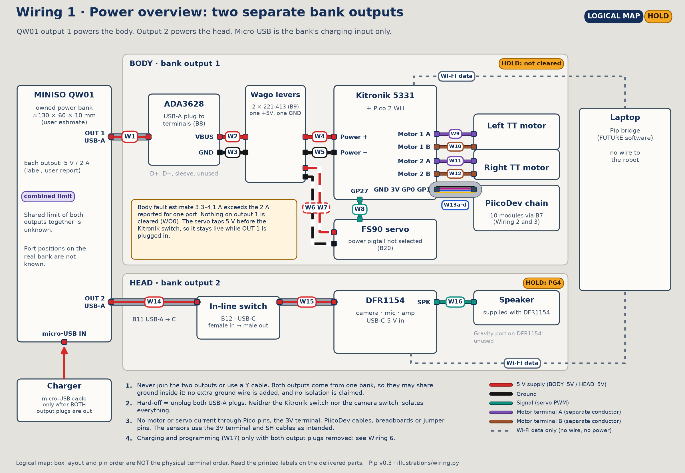
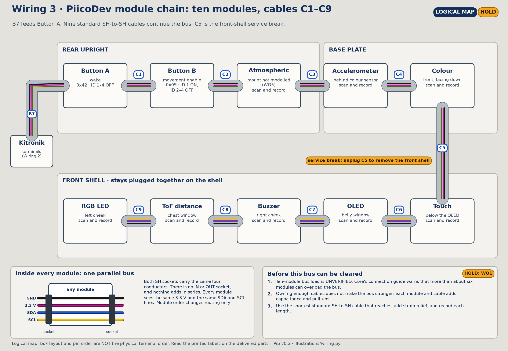
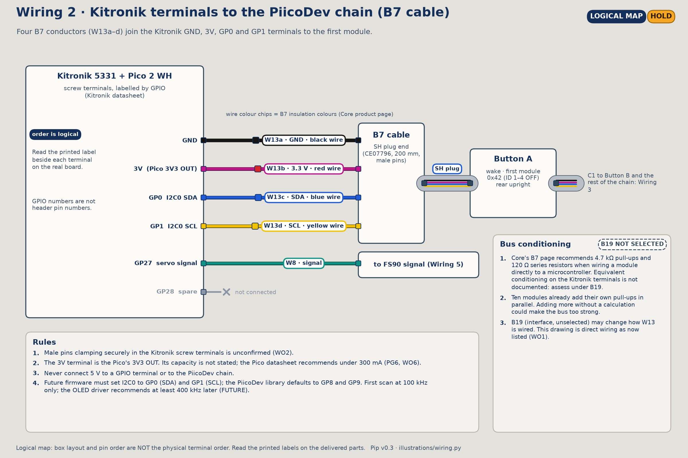
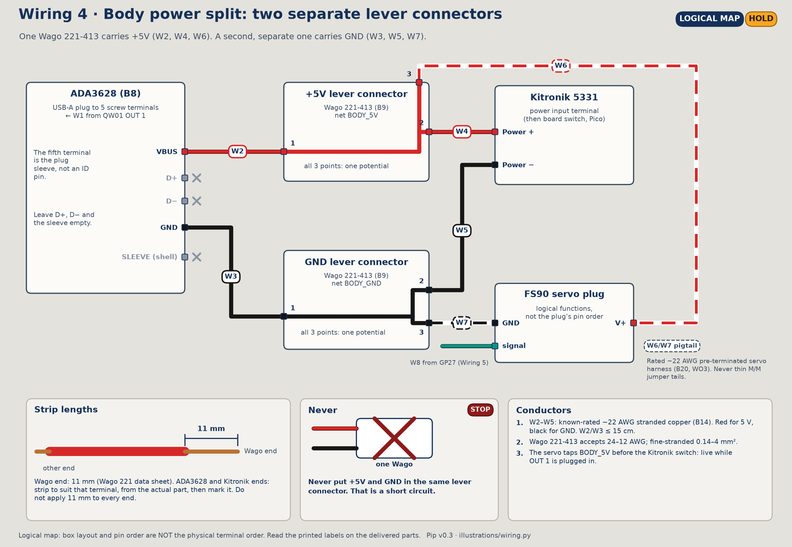
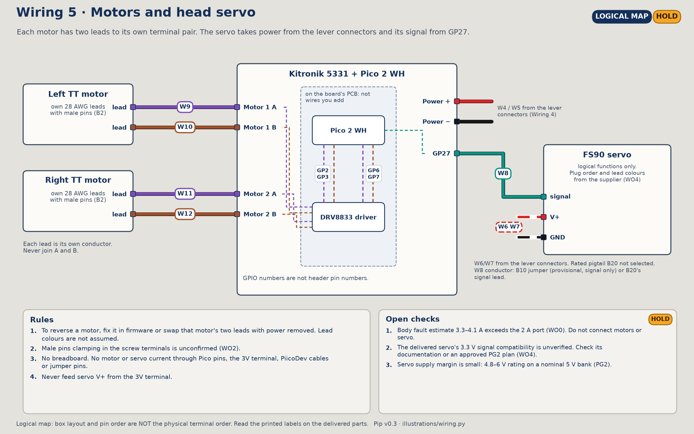
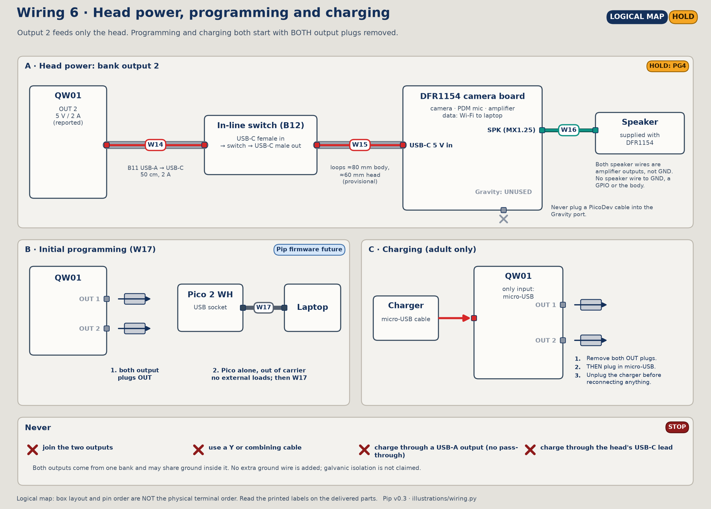

# 16 · Wire-by-wire assembly tutorial (Pip v0.3)

This tutorial walks a beginner through every electrical connection in Pip, one wire at a time. It follows the connection list in [04](04-wiring-pin-plan.md), which remains the authority on what connects to what. If this tutorial and 04 disagree, 04 wins; report the difference.

> **Status: every circuit is on HOLD.** The body branch's estimated fault current (3.3–4.1 A) exceeds the QW01's reported 5 V / 2 A per port, and the bank's combined limit is unknown. I2C bus capacity and conditioning are unresolved, the body branch has no selected protection, and no Pip firmware exists ([05](05-power-budget-charging.md) §3–5, [04](04-wiring-pin-plan.md) §9). Nobody has assembled or tested this wiring. The stages below describe how a cleared build would be wired. Only the steps marked **UNPOWERED OK** may be carried out now, and only with parts you already own.

## 0. How to use this tutorial

### Stage labels

| Label | Meaning |
|---|---|
| **UNPOWERED OK** | Safe to do now with owned parts, bank unplugged. It checks fit or sets a switch; it does not complete a circuit to a power source |
| **HOLD** | Blocked by the open items in [04](04-wiring-pin-plan.md) §9 or the gates in [05](05-power-budget-charging.md) §5. Read it, prepare for it, do not do it |
| **STOP** | A part needed for this step is not selected or not confirmed. Do not improvise a substitute |
| **FUTURE** | Needs approved diagnostic code or robot firmware, as specified by the stage |

### Diagrams are logical

Every image in this tutorial is a **logical** diagram. It shows which labelled terminal joins which. It does not show where terminals sit on the board, which way a connector faces, or the order of terminals along a block. The real order comes from the delivered part. Stage 3 has you photograph and record it before any wire goes in.

### Words used

| Word | Meaning |
|---|---|
| Terminal | A place a wire is clamped: a screw terminal or a lever connector point |
| Screw terminal | A small block where a screw tightens a clamp onto a wire end |
| Lever connector | The Wago 221-413: lift a lever, insert a stripped wire, close the lever. All three points on one connector are joined together |
| Net | A group of points that are electrically the same, such as BODY_GND |
| Strip | Remove insulation from the end of a wire to expose the copper |
| SH plug | The small 4-pin keyed plug on PiicoDev cables |
| Continuity test | A multimeter mode that beeps when two points are connected. Use it only on an unpowered circuit |
| GPIO label | The name printed next to a terminal, such as `GP0`. Not a header pin number |

### Overview



*Logical diagram.*

| Stage | What | Wires | Status |
|---|---|---|---|
| 1 | Tools | — | — |
| 2 | Parts and conductors inventory | all | UNPOWERED OK |
| 3 | Read and record the real terminal labels | all | UNPOWERED OK |
| 4 | Set up a power-off work area | — | UNPOWERED OK |
| 5 | Set the Button addresses | — | UNPOWERED OK |
| 6 | PiicoDev module chain | C1–C9 | UNPOWERED OK (fit only) |
| 7 | B7 breakout into the Kitronik terminals | W13a–d | HOLD |
| 8 | Cut and strip the body power wires | W2–W5 | HOLD |
| 9 | Body power split | W2–W5 | HOLD |
| 10 | Motors and servo | W6–W12 | HOLD; servo STOP |
| 11 | Head branch, charging and hard-off | W14–W16 | W15/W16 UNPOWERED OK (fit); W14 HOLD |
| 12 | Power-off verification | all | HOLD (after wiring) |
| 13 | Prerequisites and gated first power | W1, W14, W17 | HOLD |
| 14 | Address scan, one module at a time | — | FUTURE |
| 15 | Troubleshooting (power off) | — | — |
| 16 | Wiring log templates | — | — |

---

## Stage 1 — Tools

| Tool | Use | Notes |
|---|---|---|
| Small flat screwdriver | Kitronik and ADA3628 screw terminals | Match the blade to the actual terminal screws; measure on delivery |
| Wire stripper for ~22 AWG | W2–W5 ends | A stripper with a gauge-marked notch avoids nicking strands |
| Flush cutter | Cut B14 wire to length | Cutting wire is allowed; cutting PCB tracks or jumpers is not |
| Ruler | Measure strip lengths, including 11 mm for the lever connectors | |
| Multimeter (borrowed from school) | Continuity checks, power off | Not in the BOM. Do not use its current range anywhere in this tutorial |
| Masking tape and fine pen | Label both ends of every wire with its ID | |
| Phone camera | Record terminal labels and every finished connection | |
| Printed wiring log (Stage 16) | Record each wire as it goes in | |
| Magnifier (optional) | Read small terminal labels; check for stray strands | |

No soldering iron is needed at any stage.

---

## Stage 2 — Parts and conductors inventory

**Status:** UNPOWERED OK, for parts you own. Purchases remain on HOLD ([08](08-bom-budget-sourcing.md)).

Lay out the parts and tick each one off in the log.

| BOM | Part | Qty | Used in | Ownership |
|---|---|---|---|---|
| — | Pico 2 WH | 1 | Seated in the Kitronik board | Owned |
| — | PiicoDev modules: atmospheric, accelerometer, colour, touch, OLED, buzzer, ToF distance, RGB LED | 8 | Chain | Owned (kit) |
| — | Standard PiicoDev SH-to-SH cables | 9 needed | C1–C9 | Owned; enough for every link |
| B15 | MINISO QW01 power bank | 1 | W1, W14 | Owned |
| B1 | Kitronik 5331 | 1 | W4, W5, W8–W13 | Not bought |
| B2 | TT motor with leads | 2 | W9–W12 | Not bought |
| B3 | FS90 servo | 1 | W6–W8 | Not bought |
| B4 | DFR1154 and supplied speaker | 1 | W15, W16 | Not bought |
| B6 | PiicoDev Button | 2 | Chain | Not bought |
| B7 | PiicoDev prototyping cable (male), CE07796 | 1 | W13a–d | Ownership unconfirmed; keep AU$0.95 in budget |
| B8 | ADA3628 USB-A terminal adapter | 1 | W1–W3 | Not bought |
| B9 | Wago 221-413 lever connector | 2 | W2–W7 | Not bought |
| B10 | M/M jumper wires | as listed | W8 signal only, provisional; not needed if B20 has a signal lead | Not bought |
| B11 | USB-A → USB-C cable 50 cm | 1 | W14, W15 | Not bought |
| B12 | USB-C in-line power switch 28 cm | 1 | W15 | Not bought |
| B14 | ~22 AWG stranded copper, red and black | Measure all four routes, plus termination allowance | W2–W5 | Unpriced |
| B19 | Solder-free I2C interface / conditioning | 1 | W13, chain | **Not selected** (WO1) |
| B20 | Servo power pigtail, ~22 AWG, pre-terminated | 1 | W6, W7 | **Not selected** (WO3) |
| — | Micro-USB data cable | 1 | W17, and the bank's charge cable | Assumed owned (A4) |

The B7 cable, B14 wire, USB cables and jumpers are counted parts, not spares. Only the standard PiicoDev SH-to-SH cables are available in any quantity needed.

**Checkpoint:** every owned part is present and logged. Missing parts are listed, not substituted.

---

## Stage 3 — Read and record the real terminal labels

**Status:** UNPOWERED OK, on each part as it arrives.

The diagrams in this tutorial cannot tell you the physical order of terminals. This stage records it from the real parts.

**Parts:** Kitronik 5331 (Pico seated), ADA3628, Wago connectors, FS90, DFR1154. **Tools:** camera, magnifier, log.

1. Photograph the Kitronik board from directly above in good light. Zoom in on each terminal block until every printed label is readable.
2. In the log (Stage 16, table A), record each terminal block on the Kitronik board and the exact printed label of each terminal, in physical order. Expect labels for `GP0`, `GP1`, `GP27`, `GP28`, `3V`, `GND`, a power input pair and Motor 1 / Motor 2 pairs. Use the board's own text, including how it marks + and −.
3. Do the same for the ADA3628's five terminals: `VBUS`, `D+`, `D−`, `GND`, and the sleeve terminal.
4. For the FS90, identify V+, GND and signal from the documentation supplied with **your** servo. Record the lead colours you see. Do not take colours from a photo or another servo.
5. For the TT motors, record each motor's two lead colours. Either lead may go in either terminal of its pair.
6. Compare every label with [04](04-wiring-pin-plan.md) §3 and §5.

**Checkpoint:** table A in the log is complete, with a photo of each block. Any label that is missing, unreadable or different from 04 is marked. **STOP** on any mismatch and update 04 before wiring.

---

## Stage 4 — Set up a power-off work area

**Status:** UNPOWERED OK. Every wiring session starts here.

1. Clear a dry, non-metal surface. Remove loose metal (screws, wire offcuts) from the area.
2. Confirm the power-off state and tick it in the log:
   - both USB-A plugs are out of the QW01;
   - the QW01's micro-USB charge cable is out;
   - the Kitronik board switch is off;
   - the camera in-line switch is off;
   - the Pico's USB cable is out.
3. Put the QW01 aside, away from the robot, so it cannot be plugged in by accident.

**Checkpoint:** all five boxes ticked before the first wire is touched.

---

## Stage 5 — Set the Button addresses

**Status:** UNPOWERED OK, once the Buttons are owned. Do this before the Buttons are screwed to the upright ([14](14-illustrated-assembly-guide.md) Stage 7), while the switches are easy to reach.

Both PiicoDev Buttons arrive with the same default address, 0x42. Two modules on one bus cannot share an address, so Button B is changed using its ID switches. This is Core's no-solder method; no pad or jumper is cut or bridged.

**Parts:** 2 × PiicoDev Button, unplugged. **Tools:** a toothpick or plastic pick, camera.

1. Check that neither Button is plugged into anything.
2. Find the four-position ID switch on each Button. Read the printed position numbers (1–4) and which direction is ON.
3. **Button A (wake):** leave all four switches OFF. Address 0x42.
4. **Button B (movement enable):** set switch 1 ON and switches 2, 3, 4 OFF. Address 0x09.
5. Mark each Button "A 0x42" or "B 0x09" on masking tape on the back of the board, clear of the switch.
6. Photograph both switch settings.

| Button | ID 1 | ID 2 | ID 3 | ID 4 | Address |
|---|---|---|---|---|---|
| A | OFF | OFF | OFF | OFF | 0x42 |
| B | ON | OFF | OFF | OFF | 0x09 |

The address is 0x09 because Core's driver computes `8 + id1 + 2·id2 + 4·id3 + 8·id4` = 8 + 1 = 9 whenever any switch is on. It is not 0x43.

If you ever change a switch later, do it with the bus unpowered, then power-cycle before the next scan.

**Checkpoint:** switch photos are in the log. The addresses are confirmed only by a later scan (Stage 14).

---

## Stage 6 — PiicoDev module chain (C1–C9)

**Status:** UNPOWERED OK for a fit check. Nothing connects to the Kitronik board in this stage.



*Logical diagram. Module positions are in [11](11-mechanical-design-print-assembly.md); cable paths are not modelled.*

**What you are building.** Ten modules share four conductors: GND, 3.3 V, SDA and SCL. Each module has two identical sockets wired in parallel inside it. Neither socket is IN or OUT, and voltages do not add along the chain. Order affects routing only.

**Parts:** the modules mounted in their printed positions ([14](14-illustrated-assembly-guide.md) Stages 5, 7 and 12), nine standard PiicoDev cables. **Tools:** log, masking tape.

1. **Choose each cable by fit.** For each link below, try the shortest cable that reaches with a little slack, so it does not pull on either socket and can bend around the frame. Record the length used.
2. **Plug in.** Hold the plug by its body, line up the key with the socket, and push straight in. It should slide in with light pressure. If it does not, turn it over and check the key; never force it.
3. **Label.** Wrap a small tape flag with the cable ID near one end.

| Step | ID | From | To | Notes |
|---|---|---|---|---|
| 6.1 | C1 | Button A | Button B | Both on the rear upright, right side |
| 6.2 | C2 | Button B | Atmospheric | **STOP:** the atmospheric mount is not modelled in v0.3 (WO5). Leave C2, the atmospheric module and C3 out, and note the gap |
| 6.3 | C3 | Atmospheric | Accelerometer | Base plate, behind the colour sensor |
| 6.4 | C4 | Accelerometer | Colour | Base plate, front centre |
| 6.5 | C5 | Colour | Touch | **Front-shell disconnect.** 200 mm planned; check the shell lifts off with this cable unplugged at one end and seats again with it plugged in |
| 6.6 | C6 | Touch | OLED | Front shell |
| 6.7 | C7 | OLED | Buzzer | Front shell |
| 6.8 | C8 | Buzzer | ToF distance | Front shell. Keep the cable clear of the ToF window |
| 6.9 | C9 | ToF distance | RGB LED | Front shell. End of the chain |

To unplug any cable, grip the plug body and pull straight out. Never pull the wires.

**Checkpoint:**

- Every fitted cable seats fully and is labelled. Lengths and any blocked links, including C2/C3 until the atmospheric mount exists, are recorded in log table B.
- No cable is stretched, pinched at a shell seam or near the wheels.
- The front shell comes off by unplugging C5 only.
- One Button A socket is still free for the B7 cable.

---

## Stage 7 — B7 breakout into the Kitronik terminals (W13a–d)

**Status:** HOLD (WO1 bus conditioning, WO2 pin clamping, PG6 3 V capacity).



*Logical diagram. The terminal order on the real board comes from Stage 3, table A.*

The B7 cable has one SH plug and four male pins. Its colour code is confirmed by Core: black GND, red 3.3 V, blue SDA, yellow SCL.

**Before this stage can be cleared:** a solder-free bus-conditioning plan exists for ten modules (Core describes 4.7 kΩ pull-ups and 120 Ω series resistors in its adapters; assess the fitted module pull-ups and bus capacitance before choosing conditioning), and a delivered B7 pin has been shown to clamp securely in a Kitronik terminal. No adaptor part has been selected, and the bus interface (BOM B19) is unselected. That interface may change the direct connections below. Update 04 and this stage to match the selected interface before building.

**Parts:** B7 cable, Kitronik board with Pico seated (mounted on the upright). **Tools:** small flat screwdriver, camera, log.

| Step | ID | B7 conductor | Kitronik terminal | Signal |
|---|---|---|---|---|
| 7.1 | W13a | Black | `GND` | Ground |
| 7.2 | W13b | Red | `3V` | 3.3 V from Pico 3V3 OUT |
| 7.3 | W13c | Blue | `GP0` | I2C0 SDA |
| 7.4 | W13d | Yellow | `GP1` | I2C0 SCL |

For each row:

1. Find the terminal by its printed label (table A), not by its position in the diagram.
2. Open the terminal screw a few turns.
3. Insert the male pin fully into the clamp opening.
4. Tighten until snug. Do not overtighten; the pin is small.
5. Give the wire a gentle tug at the insulation. If the pin moves, **STOP** (WO2).
6. Photograph the terminal and tick the row in log table C.

Then plug the B7's SH plug into Button A's free socket (Stage 6).

**Checkpoint:** four conductors in four labelled terminals, matched by colour and label. Nothing on the chain touches `GP27`, `GP28` or any power terminal. The ordinary kit examples will not see this bus until firmware sets GP0/GP1 (Stage 14).

---

## Stage 8 — Cut and strip the body power wires (W2–W5)

**Status:** HOLD (WO0). The protected body power design may change the wire list.

**Parts:** B14 red and black ~22 AWG stranded copper. **Tools:** flush cutter, wire stripper, ruler, tape, pen.

| ID | Colour | Length | Lever-connector end | Other end |
|---|---|---|---|---|
| W2 | Red | ≤ 15 cm | 11 mm | ADA3628 `VBUS`: strip to suit that terminal |
| W3 | Black | ≤ 15 cm | 11 mm | ADA3628 `GND`: strip to suit that terminal |
| W4 | Red | To fit the route | 11 mm | Kitronik power +: strip to suit that terminal |
| W5 | Black | To fit the route | 11 mm | Kitronik power −: strip to suit that terminal |

1. Measure each route on the assembled frame, along the left (+Y) side behind the upright ([11](11-mechanical-design-print-assembly.md)). Add a little slack. Keep W2 and W3 at 15 cm or less.
2. Cut each wire.
3. Strip the lever-connector end to **11 mm**, as specified on the Wago data sheet. Check with the ruler.
4. Strip the screw-terminal end only as long as that terminal's clamp. Measure the real terminal; do not use 11 mm there.
5. Twist the strands lightly so none stray. Do not tin them; that needs solder.
6. Inspect each end: no cut or nicked strands, no insulation left in the stripped length.
7. Tape-label both ends with the wire ID.

**Checkpoint:** four labelled wires with correct strip lengths at each end, logged in table C.

---

## Stage 9 — Body power split: ADA3628 → lever connectors → Kitronik (W2–W5)

**Status:** HOLD (WO0, PG1, PG3).



*Logical diagram.*

Each Wago 221-413 has three clamping points, all joined together. One connector is the +5V net and one is the GND net. Each uses all three points: one in from the ADA3628, one out to the Kitronik board, one out to the servo (Stage 10).

**Parts:** ADA3628 (**not** plugged into the bank), 2 × Wago 221-413, W2–W5. **Tools:** small flat screwdriver, tape, log.

**ADA3628 end:**

1. Label one Wago "+5V" and the other "GND".
2. Open the ADA3628's `VBUS` screw. Insert W2's stripped end fully, so no bare copper shows outside the clamp. Tighten. Tug gently.
3. Repeat for W3 into `GND`.
4. Leave `D+`, `D−` and the sleeve terminal empty.

**Lever connectors:**

5. Lift lever 1 on the +5V Wago. Push W2's 11 mm end in until it stops. Close the lever. Check through the clear housing that the copper reaches the end. Tug gently.
6. Repeat for W3 into lever 1 of the GND Wago.

**Kitronik end:**

7. Check the Kitronik switch is off.
8. Insert W4 into lever 2 of the +5V Wago. Insert its other end into the Kitronik power input terminal marked + (table A). Tighten and tug.
9. Insert W5 into lever 2 of the GND Wago and into the Kitronik power input terminal marked −. Tighten and tug.

| Step | ID | From | To |
|---|---|---|---|
| 9.2 | W2 | ADA3628 `VBUS` | +5V Wago, point 1 |
| 9.3 | W3 | ADA3628 `GND` | GND Wago, point 1 |
| 9.8 | W4 | +5V Wago, point 2 | Kitronik power + |
| 9.9 | W5 | GND Wago, point 2 | Kitronik power − |

W5 also provides the common body ground: the Pico, the `GND` terminal and the servo all reach it through the board and the GND Wago.

**Checkpoint:** red to +, black to −, at both ends. Point 3 on each Wago is empty, ready for the servo. No bare copper outside any clamp. The ADA3628 is still unplugged. Photos and ticks in log table C.

---

## Stage 10 — Motors (W9–W12) and servo (W6–W8)

**Status:** HOLD (WO0, WO2, PG3). Servo power is **STOP** until a pigtail is selected (WO3).



*Logical diagram.*

### 10a. Motors

**Parts:** both TT motors, mounted ([14](14-illustrated-assembly-guide.md) Stage 5), with leads fed to the rear. **Tools:** small flat screwdriver.

| Step | ID | Motor lead | Kitronik terminal |
|---|---|---|---|
| 10.1 | W9 | Left motor, lead A | Motor 1, first terminal |
| 10.2 | W10 | Left motor, lead B | Motor 1, second terminal |
| 10.3 | W11 | Right motor, lead A | Motor 2, first terminal |
| 10.4 | W12 | Right motor, lead B | Motor 2, second terminal |

1. Record which colour you call "A" for each motor in the log.
2. Insert each male pin fully, tighten, tug gently. If a pin will not hold, **STOP** (WO2).
3. Route the leads away from the wheels and the shaft ends.

Motor 1 is driven by GP2/GP3, Motor 2 by GP6/GP7. Direction is set in firmware. If a wheel later turns backwards, either change firmware or swap that motor's two leads with power removed.

### 10b. Servo

The servo takes power from point 3 of each Wago (upstream of the Kitronik switch) and its signal from `GP27`.

**STOP for W6 and W7.** The plan needs a known-rated, pre-terminated servo power pigtail of about 22 AWG that mates with the FS90's plug. No such part is selected. Do not use B10 jumper ends or any thin wire of unknown rating for servo power into the Wago.

| Step | ID | From | To | Conductor |
|---|---|---|---|---|
| 10.5 | W6 | +5V Wago, point 3 | Servo V+ | Selected pigtail (WO3) |
| 10.6 | W7 | GND Wago, point 3 | Servo GND | Selected pigtail (WO3) |
| 10.7 | W8 | Kitronik `GP27` | Servo signal | B10 jumper, or the pigtail's signal conductor |

When the pigtail exists:

1. Identify V+, GND and signal on the servo from your Stage 3 record.
2. Mate the pigtail with the servo plug, matching V+ to V+, GND to GND, signal to signal.
3. Strip and insert the pigtail's power ends into point 3 of each Wago, following the pigtail's own specification and the 11 mm Wago strip length.
4. Connect W8 from `GP27` to the signal contact.
5. Route the servo lead down through the deck slot ([14](14-illustrated-assembly-guide.md) Stage 8) with enough slack for the head's ±75° travel.

Whether the FS90 accepts a 3.3 V signal is not stated by any source used here; it is checked at PG2.

**Checkpoint:** motor pins secure; servo row either complete with the selected pigtail or marked STOP in the log. Nothing on the servo branch connects to the `3V` terminal.

---

## Stage 11 — Head branch (W14–W16), charging and hard-off



*Logical diagram.*

The head has its own USB supply from bank output 2 and talks to the laptop over Wi-Fi. No external wire runs between the head and any body terminal. Both branches use the same bank; their grounds may be joined inside it. Do not assume electrical isolation.

### 11a. Speaker and USB-C into the head (W15, W16)

**Status:** UNPOWERED OK as a fit check, as in [14](14-illustrated-assembly-guide.md) Stage 10.

1. Plug the supplied speaker's plug into the DFR1154's speaker socket. That is the speaker's only connection. Both speaker wires are amplifier outputs; neither goes to ground or anywhere else.
2. Leave the DFR1154's Gravity connector empty. It resembles a PiicoDev socket, but a PiicoDev cable must never go into it.
3. Plug the B12 in-line switch's USB-C male end into the DFR1154's USB-C socket.
4. Route the B12 cable down the neck with ~60 mm of service loop in the head and ~80 mm in the body.
5. Plug B11's USB-C end into B12's USB-C female end. Set the in-line switch off.

### 11b. Into the bank (W14)

**Status:** HOLD (PG4). B11's USB-A end goes into QW01 output 2 only during gated bring-up (Stage 13).

### 11c. Hard-off and charging

These are procedures, not wires.

- **Hard-off:** pull both USB-A plugs out of the QW01. The Kitronik switch leaves the servo branch live, and the in-line switch covers only the head.
- **Charging:** both robot USB-A plugs out first. Then plug the charge cable into the QW01's micro-USB input. Nothing else charges the bank ([05](05-power-budget-charging.md) §6).
- **Programming (W17):** both robot USB-A plugs out and charge cable out. For initial programming, remove the Pico from the carrier and attach no external loads before connecting its USB to the laptop. A mounted programming setup needs a reviewed carrier USB power path and load budget; it is not cleared here.

**Checkpoint:** speaker plug and USB-C seated; Gravity connector empty; B11's USB-A end free and away from the bank.

---

## Stage 12 — Power-off verification

**Status:** HOLD, run after Stages 7–11. Every check here is done with the Stage 4 power-off state.

### 12a. Visual check

Go through log table C, row by row, against [04](04-wiring-pin-plan.md) §5:

- [ ] Each wire's two ends are at the labelled terminals in the table, checked against the printed labels (table A), not against a diagram.
- [ ] Red to + / `VBUS` / `3V`, black to − / `GND`, blue to `GP0`, yellow to `GP1`.
- [ ] No bare copper outside a clamp; no stray strand touching a neighbouring terminal.
- [ ] `D+`, `D−`, sleeve, `GP28` and the Gravity connector are empty.
- [ ] No 5 V wire touches a GPIO terminal, the `3V` terminal or the PiicoDev chain.
- [ ] No added wire or Y cable joins the two USB outputs. Internal bank connections are outside this check.
- [ ] Every connection is photographed.

### 12b. Second-person check

A second person, ideally the supervising teacher, repeats 12a independently from the photos and the robot, and signs log table D.

### 12c. Continuity checks (unpowered only)

Set the multimeter to continuity. Confirm the Stage 4 power-off state again. Probe screw heads and terminal metal, never the inside of an SH socket.

| # | Probe 1 | Probe 2 | Expect | If not |
|---|---|---|---|---|
| K1 | ADA3628 `VBUS` screw | Kitronik power + screw | Tone | Check W2, W4, both levers closed, strip lengths |
| K2 | ADA3628 `GND` screw | Kitronik power − screw | Tone | Check W3, W5 |
| K3 | ADA3628 `GND` screw | Kitronik `GND` terminal | Tone (through the board) | Record; check the board's documentation |
| K4 | ADA3628 `VBUS` screw | ADA3628 `GND` screw | **No steady tone** | See below |
| K5 | ADA3628 `VBUS` screw | Kitronik `3V`, `GP0`, `GP1`, `GP27` in turn | No steady tone | Look for a stray strand or misplaced wire |

**Reading K4.** A brief chirp that stops by itself can come from capacitors on the board charging from the meter's test current. That alone is not a short. A tone that stays on, or a resistance reading that stays near 0 Ω, is a suspected short: stop and use Stage 15.

**Readings you may see on the bus.** Between `GP0` or `GP1` and `3V`, the meter may show a resistance rather than an open circuit, through the modules' pull-up resistors. Record it; it is not a fault by itself.

Never switch the meter to a current (A or mA) range for these checks or put it across a supply. A current range is nearly a short circuit.

**Checkpoint:** K1–K5 recorded in log table D; 12a and 12b signed.

---

## Stage 13 — Prerequisites and gated first power

**Status:** HOLD.

Two different kinds of condition apply. Keeping them separate avoids a circular plan in which a test needs power before power is allowed.

**Prerequisites (decided on paper, before any power):**

1. A protected body power design is selected and documented, and [04](04-wiring-pin-plan.md) §5 is updated for it (WO0; [05](05-power-budget-charging.md) §4).
2. QW01 limits are documented as far as available: per-port and combined ratings, charge input, protection (the documentation part of PG1).
3. The bus-conditioning plan for ten modules is calculated and selected (WO1).
4. Pin clamping is confirmed (WO2), the servo pigtail is selected (WO3) and the servo leads are identified (WO4).
5. A teacher has reviewed a guarded, current-limited bench test plan (PG3), including the servo signal specification or a controlled method to evaluate it.
6. Approved diagnostic code exists for the subsystem under test, with GP0/GP1 explicitly configured when used. The bench setup keeps motors disconnected until safe boot behaviour can be tested. Full robot operation additionally needs Pip firmware, command expiry and movement-enable logic (WO7, PG7).
7. Stage 12 is complete and signed.

**Measured gates (only after every prerequisite, under the teacher's plan):** PG1's measured items, PG2 (servo supply during motion), PG4 (camera supply), PG6 (3V/regulator load and I2C bus behaviour), PG7 (reset behaviour). PG5 (hard-off and charge access) is a physical check that can be done unpowered.

The teacher's plan sets the order and the equipment. As a reference only, the earlier sequence was:

1. ADA3628 alone into output 1 (W1), nothing else connected: check `VBUS` voltage at its terminals.
2. Keep motor and servo leads disconnected for controller-only bring-up. Under the approved plan, connect the controller supply with its switch off, then switch on and verify the power indicator and Pico boot. Reconnect actuators only in the later guarded tests.
3. I2C scan on GP0/GP1 (Stage 14).
4. Servo branch, under PG2.
5. Head branch (W14), under PG4.

A failed or unexpected result at any point: hard-off first (both USB-A plugs out), then diagnose with power removed (Stage 15).

---

## Stage 14 — Address scan, one module at a time

**Status:** FUTURE. Needs compatible MicroPython, approved diagnostic code and the applicable Stage 13 prerequisites. The scan itself is one measured bring-up check; it does not require all later robot tests to have passed. Nothing here has been run.

The aim is an address log built one module at a time, so each address is tied to a known module rather than guessed.

1. Power off. Connect only the B7 cable and Button A.
2. Power on under the bring-up plan. Scan and record the addresses found.
3. Power off. Add the next module with its cable. Power on, scan, and record which new address appeared.
4. Repeat for every module. Expect Button A at 0x42 and Button B at 0x09. Record every other address as found; do not fill it in from a listing.
5. If an address repeats, or a module adds no address, stop and record it.

A minimal MicroPython sketch for the scan step, for reference only. It is not Pip firmware and has not been run on this hardware:

```python
# Reference sketch only. Not run; not Pip firmware.
from machine import I2C, Pin

# Pip uses I2C0 on GP0 (SDA) and GP1 (SCL), not the kit examples' GP8/GP9.
i2c = I2C(0, sda=Pin(0), scl=Pin(1), freq=100_000)
print([hex(a) for a in i2c.scan()])
```

PiicoDev driver examples must likewise be configured for GP0/GP1; their defaults assume the kit's expansion board. The [Core Unified driver](https://raw.githubusercontent.com/CoreElectronics/CE-PiicoDev-Unified/main/PiicoDev_Unified.py) uses GP8/GP9 by default and recommends at least 400 kHz for OLED use. The 100 kHz scan above only discovers addresses. Validate the full bus separately at its intended operating speed.

**Checkpoint (future):** log table E lists every module with its scanned address and the scan date.

---

## Stage 15 — Troubleshooting (power off)

Every fix below is done in the Stage 4 power-off state.

| Symptom | Likely cause | Action |
|---|---|---|
| A printed label differs from 04 | Different board revision or misread | STOP; record and update 04 before wiring |
| SH plug will not go in | Upside down, or wrong socket type | Check the key; never force. Check it is not the DFR1154's Gravity connector |
| Cable is tight when the front shell is removed | C5 too short | Use the next longer standard cable |
| Male pin turns or slides out of a screw terminal | Pin too small for the clamp | STOP (WO2); do not pack it with extra wire |
| Stripped wire pulls out of a Wago | Not fully inserted, lever not closed, or strip too short | Re-strip to 11 mm, insert to the stop, close the lever |
| Bare copper visible outside a screw terminal | Strip too long | Cut back and re-strip to the terminal's length |
| Stray strand near a neighbour | Strands not twisted, or nicked while stripping | Remove the wire, cut back, re-strip |
| K1 or K2: no tone | Lever open, wire in the wrong point or terminal, broken strand | Check each end; re-seat |
| K4 or K5: steady tone | Possible short, or a semiconductor path through attached electronics | Stop. Disconnect power first, isolate the passive harness from boards and recheck it. Ask the teacher to interpret board-connected readings; a tone alone does not identify a faulty wire |
| K4: one short chirp only | Board capacitors charging from the meter | Not a fault by itself; record it |
| Bus pins show a resistance to `3V` | Module pull-ups | Not a fault by itself; record it |
| Servo lead colours do not match a picture | Pictures are not authoritative | Use your servo's own documentation (Stage 3) |

If a check fails during powered bring-up, the first action is always hard-off. Diagnosis then continues here, with power removed.

---

## Stage 16 — Wiring log templates

Print these or copy them into the build log.

**A. Terminal labels as delivered** (Stage 3)

| Part | Block | Labels in physical order, as printed | Photo # |
|---|---|---|---|
| Kitronik 5331 | | | |
| ADA3628 | | | |
| FS90 lead colours (from its documentation) | | | |
| TT motor lead colours (left / right) | | | |

**B. PiicoDev cables** (Stage 6)

| ID | From | To | Length used | Seats fully | Photo # |
|---|---|---|---|---|---|
| C1 | Button A | Button B | | | |
| C2 | Button B | Atmospheric | | | |
| C3 | Atmospheric | Accelerometer | | | |
| C4 | Accelerometer | Colour | | | |
| C5 | Colour | Touch | | | |
| C6 | Touch | OLED | | | |
| C7 | OLED | Buzzer | | | |
| C8 | Buzzer | ToF distance | | | |
| C9 | ToF distance | RGB LED | | | |

**C. Wires** (Stages 7–11)

| ID | From | To | Colour | Strip length (each end) | Tug test | Photo # | Date / initials |
|---|---|---|---|---|---|---|---|
| W1 | QW01 output 1 | ADA3628 plug | — | — | — | | |
| W2 | ADA3628 `VBUS` | +5V Wago 1 | Red | | | | |
| W3 | ADA3628 `GND` | GND Wago 1 | Black | | | | |
| W4 | +5V Wago 2 | Kitronik power + | Red | | | | |
| W5 | GND Wago 2 | Kitronik power − | Black | | | | |
| W6 | +5V Wago 3 | Servo V+ | | | | | |
| W7 | GND Wago 3 | Servo GND | | | | | |
| W8 | `GP27` | Servo signal | | | | | |
| W9 | Left motor A | Motor 1 | | — | | | |
| W10 | Left motor B | Motor 1 | | — | | | |
| W11 | Right motor A | Motor 2 | | — | | | |
| W12 | Right motor B | Motor 2 | | — | | | |
| W13a | `GND` | B7 | Black | — | | | |
| W13b | `3V` | B7 | Red | — | | | |
| W13c | `GP0` | B7 | Blue | — | | | |
| W13d | `GP1` | B7 | Yellow | — | | | |
| W14 | QW01 output 2 | B11 USB-A | — | — | — | | |
| W15 | B11 USB-C → B12 | DFR1154 USB-C | — | — | — | | |
| W16 | DFR1154 speaker socket | Speaker | — | — | — | | |
| W17 | Pico USB | Laptop, bank unplugged | — | — | — | | |

**D. Power-off verification** (Stage 12)

| Check | Result | Initials |
|---|---|---|
| 12a visual | | |
| 12b second person | | |
| K1 | | |
| K2 | | |
| K3 | | |
| K4 | | |
| K5 | | |

**E. Address log** (Stage 14, future)

| Order added | Module | Address found | Date |
|---|---|---|---|
| 1 | Button A | | |
| 2 | Button B | | |
| … | | | |

## Editing the tutorial and diagrams

Edit the steps in this Markdown file. The wire IDs must match [04](04-wiring-pin-plan.md). Editable SVG diagrams sit beside their PNGs in [images/wiring](images/wiring/). The [illustration source and regeneration instructions](../illustrations/README.md) explain how to edit labels, layouts and CAD close-ups. Run `scripts/illustrations.sh` and `python3 scripts/check_docs.py` after changing them.
